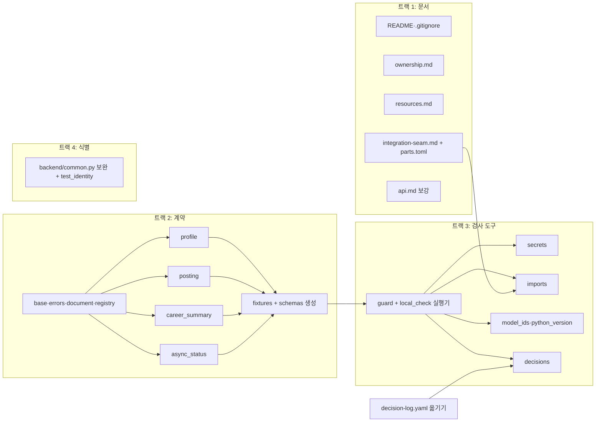
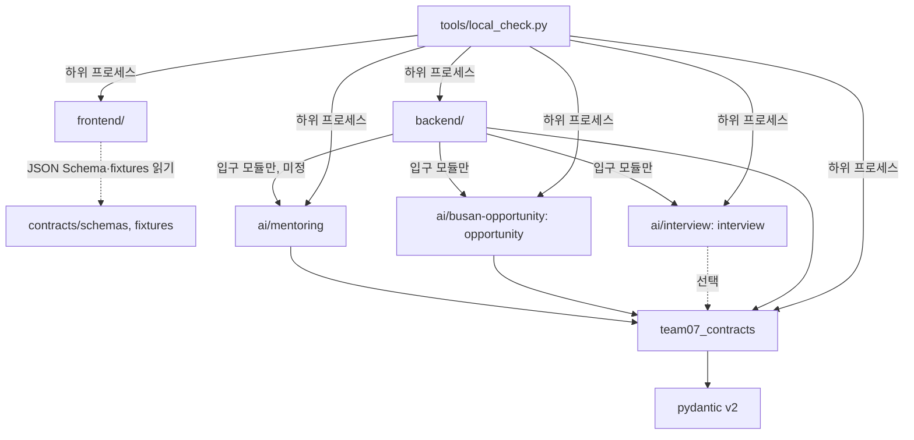
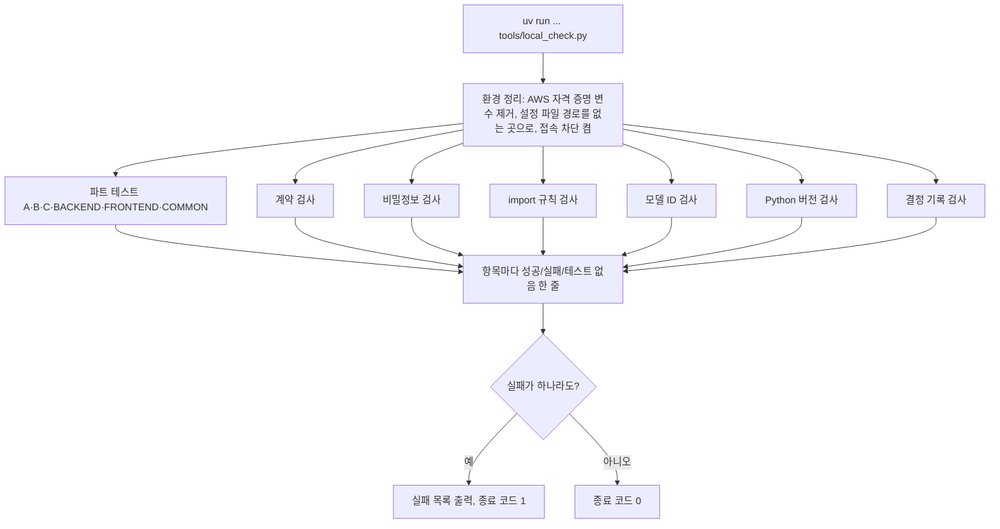
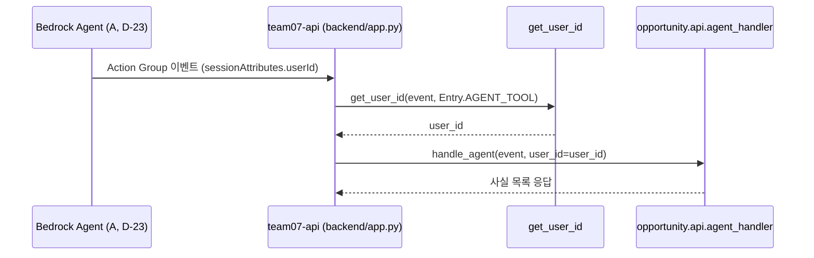

# Design Document

## Overview

공통 기반(common-foundation)은 A·B·C·BACKEND·FRONTEND가 서로를 기다리지 않고 개발하도록 계약, 예시 데이터, 사용자 식별 경계, 연결 경계, 이름 규칙, 결정 기록, 로컬 확인 절차를 만든다. 기준은 같은 폴더의 `requirements.md`(Requirement 1~14와 "결정 기록")이고, 각 Requirement 첫머리의 "결정 반영" 문단이 기준 본문보다 우선한다.

### 출발점 (현재 `main`)

새로 만들지 않고 이미 있는 것을 기준으로 빈 곳을 채운다.

| 이미 있음 | 설계에서 하는 일 |
|---|---|
| `README.md`, `.gitignore`, `.python-version`(`3.13`) | 폴더·소유 표, Local_Check 명령, 예시 데이터 위치를 README에 더하고, `.gitignore` 범주를 채운다 (R1) |
| `docs/api.md` v1.0 (D-01~D-06, D-29~D-31 반영) | API_Convention_Doc으로 쓰고 R3의 빠진 절만 보강한다 |
| `docs/db-schema.md` v1.3 | 계약 필드 이름의 기준으로 읽기만 한다 (변경 없음) |
| `backend/common.py` `get_user_id()`, `TeamError`, `error_response()` | Identity_Resolver(D-07·D-35)로 쓰고 R6에 맞게 고친다 |
| `backend/interview_api.py` (C 함수 호출, 대역 `interview_stub`) | Integration_Seam_Doc의 C 입구 기준으로 삼는다 |
| `infra/package.sh` (`ai/interview/*.py` → `interview` 패키지) | D-17 패키징 방식의 기준으로 적는다 |
| `ai/{mentoring,busan-opportunity,interview}/`, `frontend/` (`.gitkeep`만) | 내부 구조는 후속 스펙에 맡긴다 |

### 산출물

| 산출물 | 위치 | 소유 |
|---|---|---|
| Contract_Package (Pydantic v2 모델, 변환 함수, 오류 코드 목록, 계약 목록) | `contracts/src/team07_contracts/` (D-18) | COMMON |
| JSON Schema (프론트·비 Python 소비자용, 모델에서 생성) | `contracts/schemas/*.schema.json` | COMMON |
| Fixture_Set | `contracts/fixtures/{valid,invalid}/*.json` | COMMON |
| Local_Check와 검사 도구 | `tools/local_check.py`, `tools/checks/`, `tools/guard/`, `tools/parts.toml` | COMMON |
| Decision_Log (기계 검사용) | `docs/decisions/decision-log.yaml` | COMMON |
| Ownership_Map + Contract_Change_Procedure | `docs/conventions/ownership.md` | COMMON |
| Integration_Seam_Doc | `docs/conventions/integration-seam.md` | COMMON |
| Resource_Naming_Convention | `docs/conventions/resources.md` | COMMON |
| API_Convention_Doc 보강 | `docs/api.md` | COMMON |
| Identity_Resolver 보완 + 테스트 | `backend/common.py`, `backend/tests/test_identity.py` | BACKEND (인증 변경이라 리뷰 요청) |

### 설계 원칙

- 공통 기반은 해커톤 0~2시간 안에 첫 사용 가능한 상태가 되어야 한다 (B §9, C §9). 그래서 계약 모델과 예시 데이터를 먼저 만들고, 검사 도구는 그 뒤에 붙인다 ("병렬 개발과 후속 스펙 착수 조건").
- 새 라이브러리는 Pydantic v2(계약 기준, AGENTS.md), pytest(명세의 테스트 도구), Hypothesis(속성 테스트), PyYAML(결정 기록 읽기)만 쓴다. 앞의 하나는 계약 실행에 필요하고 뒤의 셋은 개발·검사용이다.
- 계약 모델은 실행 중 AWS·네트워크·파일을 부르지 않는 순수 코드다.
- `CONFIRMED`가 아닌 결정에 걸리는 부분은 `[D-xx 상태]`로 표시하고 Seam 뒤에 둔다 (R14.3).

### 이 설계가 새로 올리는 결정 항목

설계 중 찾은 미확정 항목이다. 출처는 이 스펙의 Requirement 번호다 (R14.2). Decision_Log로 옮길 때 함께 넣는다.

| ID | 항목 | 제안 | 상태 |
|---|---|---|---|
| D-38 | 채용정보 수집원 범위 (product.md "범위 관련 미확정" 셋째 항목) | 없음. 이유: B 소유 (busan-opportunity-data) | OPEN |
| D-39 | 공고 스냅샷과 요건 추출 시점 (R8.3과 db-schema §3 "추출하면 같은 스냅샷에 채운다"의 충돌) | Posting_For_Analysis는 `extractStatus`가 완료된 스냅샷에서만 만든다. 완료 뒤 요건이나 `jobDescription`이 바뀌면 새 `snapshotId`를 쓴다 | PROPOSED (A + B) |
| D-40 | Career_Profile_Summary 목록 한도 (R9.1) | `projects` 10개·항목 200자, `skills` 30개·항목 50자, `needsConfirmation` 10개·항목 200자 | PROPOSED (A + C) |
| D-41 | `evaluate_eligibility` 위치 (D-11 보완, R12.4와 충돌) | 구현을 `team07_contracts.eligibility`로 옮기고 `backend/eligibility.py`는 다시 내보내기만 한다. 대안: 백엔드가 판정해 A·B 입구에 결과를 넘긴다 | PROPOSED (A + B + BACKEND) |

D-41이 필요한 이유: D-11은 판정을 `backend/eligibility.py` 하나로 정했지만, R12.4는 `ai/` 아래 코드가 `backend/`를 import하지 못하게 한다. A·B의 `ai/` 코드가 직접 판정을 부를 수 없다. `backend/eligibility.py`는 표준 라이브러리만 쓰는 순수 함수라 옮기는 비용이 작다.

## 요구사항 대응표

| 구성 요소 | 위치 | Requirement |
|---|---|---|
| Repository_Baseline | `README.md`, `.gitignore`, `.python-version`, 파트별 `requirements.txt`·`tests/`·`local-check.toml` | 1.1~1.4, 1.7 |
| Local_Check 실행기 | `tools/local_check.py` | 1.5~1.9, 10.7, 11.5, 11.10, 13.7, 14.6, 14.9 |
| 외부 접속 차단 | `tools/guard/sitecustomize.py` | 1.5, 1.9 |
| Ownership_Map, Contract_Change_Procedure | `docs/conventions/ownership.md`, `tools/checks/ownership.py` | 2.1~2.8, 10.2, 10.5, 14.4, 14.8 |
| API_Convention_Doc | `docs/api.md` | 3.1~3.10, 3.12, 3.13 |
| `score` 필드 금지 검사 | `contracts/tests/test_schema_rules.py` | 3.11 |
| ErrorEnvelope, Error_Code_Catalog, InterviewError 변환 | `team07_contracts/errors.py` | 4.1~4.9 |
| Async_Task_Status, Status_Extension | `team07_contracts/async_status.py` | 5.1~5.8 |
| Identity_Resolver | `backend/common.py` | 6.1~6.12 |
| Common_Profile | `team07_contracts/profile.py` | 7.1~7.10 |
| Posting_For_Analysis와 변환 | `team07_contracts/posting.py` | 8.1~8.12 |
| Career_Profile_Summary와 대응표 | `team07_contracts/career_summary.py`, `docs/conventions/integration-seam.md` | 9.1~9.9 |
| 계약 버전·계약 목록 | `team07_contracts/registry.py`, `team07_contracts/document.py` | 10.1~10.7 |
| Fixture_Set | `contracts/fixtures/` | 11.1~11.11 |
| Integration_Seam_Doc, `tools/parts.toml` | `docs/conventions/integration-seam.md` | 12.1~12.3, 12.6, 12.9 |
| Import_Rule_Checker | `tools/checks/imports.py` | 12.4, 12.5, 12.7, 12.8 |
| Resource_Naming_Convention | `docs/conventions/resources.md` | 13.1~13.4, 13.9 |
| Secret_Scanner | `tools/checks/secrets.py` | 11.6, 11.11, 13.5~13.7 |
| 모델 ID 리터럴 검사 | `tools/checks/model_ids.py` | 13.8 |
| Python 버전 검사 | `tools/checks/python_version.py` | 1.3 |
| Decision_Log | `docs/decisions/decision-log.yaml`, `tools/checks/decisions.py` | 14.1~14.9 |

## 병렬 개발과 후속 스펙 착수 조건

### 후속 스펙별 착수 조건

| 후속 스펙 | 착수에 필요한 Foundation 산출물 | Foundation 완료 전에 시작할 수 있는 일 | 막는 결정 |
|---|---|---|---|
| backend-platform | Identity_Resolver 보완, ErrorEnvelope·코드 목록, `docs/api.md` 보강 | `backend/tests/`로 테스트 옮기기, 기본 값으로 쓰는 자원 이름 제거(R13.2) | D-41 (`package.sh`에 `contracts/` 포함 여부) |
| mentoring-profile-storybank | Career_Profile_Summary, Common_Profile, 예시 데이터 | NCS CSV 적재기, MockLLM fixture, 문서 추출 | D-40 |
| mentoring-fit-review-learning | Posting_For_Analysis, Job_Requirement_View, 공고 예시 데이터 | 적합도 규칙 코드(예시 공고 사용) | D-39, D-41 |
| mentoring-agent-quality | Integration_Seam_Doc의 Agent 입구 규칙 | 평가셋 준비 | D-23 OPEN (Seam 없음: 구현은 확정 뒤) |
| busan-opportunity-data | Posting_For_Analysis, `compute_content_hash` | 공공 API 수집 스크립트, 시드·데모 스냅샷 준비 | D-38, D-39 |
| busan-opportunity-recommend | Common_Profile 페르소나 예시, 공고 예시, B 입구 서명 | `core/` 순수 규칙 (T-01~T-22) | D-41 |
| busan-opportunity-notify | ErrorEnvelope, Async_Task_Status | 알림 문구, 일정 계산 규칙 | 없음 |
| interview-functions | InterviewError 대응표, Career_Profile_Summary, Interview_Job_Context | 함수 전체 (백엔드가 이미 대역으로 연결) | 없음 |
| frontend-app | JSON Schema, Fixture_Set, `docs/api.md` | 화면 초안, 문구, 녹음·캡처 시험 | D-24 OPEN (프레임워크) |
| integration-e2e | 모든 계약과 Local_Check | 데모 시나리오 문서 (D-37) | D-27 OPEN |

계약 모델과 예시 데이터가 들어오면 A·B·C·FRONTEND는 서로의 구현 대신 예시 데이터로 개발한다. Identity_Resolver, 오류 형식, `docs/api.md`가 들어오면 backend-platform이 시작한다.

### Foundation 내부 작업 순서



- 네 트랙은 서로 다른 사람이 동시에 할 수 있다. 맞물리는 곳은 `parts.toml`(트랙 1 → import 검사)과 `decision-log.yaml`(→ 결정 기록 검사), 계약 테스트(트랙 2 → Local_Check 계약 단계)뿐이다.
- 첫 2시간 목표: 트랙 2의 C1~C6, 트랙 4, `docs/api.md` 보강. 이것만 있으면 모든 파트가 시작할 수 있다. 트랙 3은 그 뒤에 붙여도 다른 파트를 막지 않는다.

## Architecture

### 저장소 배치

```
README.md                     폴더·소유 표, Local_Check 명령, Python 버전 안내 (COMMON)
.gitignore  .python-version   (COMMON)
AGENTS.md  .kiro/steering/    (COMMON)
contracts/                    Contract_Package (COMMON, D-18)
  requirements.txt            pydantic>=2.7,<3
  src/team07_contracts/       계약 모델·변환 함수 (import 이름 team07_contracts)
  schemas/                    모델에서 생성한 JSON Schema (커밋 대상)
  fixtures/valid/  fixtures/invalid/
  tests/
tools/                        Local_Check와 검사 도구 (COMMON)
  local_check.py  parts.toml  secret-allowlist.toml  requirements.txt  test-tools.txt
  checks/  guard/sitecustomize.py  tests/
docs/
  api.md                      API_Convention_Doc (COMMON)
  db-schema.md  team-guide.md (BACKEND)
  conventions/ownership.md  integration-seam.md  resources.md   (COMMON)
  decisions/decision-log.yaml (COMMON)
  개발계획서1~3.md  프로젝트_제안서.md  CONTRIBUTING.md   (원문, 바꾸지 않음)
ai/mentoring/                 A (requirements.txt, tests/, 내부 구조는 후속 스펙)
ai/busan-opportunity/         B (src/opportunity/, B §13)
ai/interview/                 C (평면 구조 = interview 패키지, infra/package.sh)
backend/                      BACKEND (단일 Lambda team07-api)
frontend/                     FRONTEND
infra/  examples/             BACKEND
```

- `contracts/`는 D-18 결정("기계 검사용 Contract_Package는 만들 때 새 최상위 `contracts/`")을 따른다. import 이름을 `team07_contracts` 하나로 두어 위치를 옮겨도 import 문은 그대로다. `common`이라는 이름은 `backend/common.py`와 겹쳐 import 검사에서 구분이 안 되므로 쓰지 않는다.
- `contracts/`를 `backend/` 아래에 두지 않는 이유: R12.4가 `ai/`에서 `backend/` import를 막기 때문이다.

### 의존 방향



- 화살표가 없는 방향(`ai/*` → `backend/`, 파트 → 다른 파트)은 Import_Rule_Checker가 막는다 (R12.4, R12.5).
- 사용자 ID는 백엔드가 `get_user_id()`로 읽어 파트 입구에 인자로 넘긴다. 파트 코드는 토큰이나 `sessionAttributes`를 직접 읽지 않는다 (R6.1, R12.6).

### 패키징 (D-17 CONFIRMED)

- 단일 Lambda `team07-api`. `infra/package.sh`가 `backend/*.py`(테스트 제외)와 `ai/interview/*.py`(`interview` 패키지)를 묶는다.
- B는 `ai/busan-opportunity/src/opportunity/`를 `opportunity` 패키지로, A는 정해지면 같은 방식으로 묶는다. `package.sh` 변경은 backend-platform 작업이고 배포 변경이라 사용자 확인이 필요하다 (AGENTS.md "환경·보안").
- 실행 중 `team07_contracts`를 import하는 파트가 생기면 `package.sh`가 `contracts/src/team07_contracts/`를 같이 묶고 `contracts/requirements.txt`(pydantic)를 설치한다 [D-41 PROPOSED]. Foundation 범위에서는 실행 코드가 `team07_contracts`를 import하지 않는다. Identity_Resolver는 표준 라이브러리만 쓰는 `backend/common.py`에 남는다.
- 파트는 `team07_contracts`를 자기 `requirements.txt`에 적지 않는다. 테스트 때는 Local_Check가 `PYTHONPATH`로, 배포 때는 `package.sh`가 경로로 넣는다. `uv pip install --target`이 경로 의존성을 Lambda용으로 풀지 못하는 문제를 피하려는 것이다.

### Local_Check 흐름



모든 단계는 앞 단계 결과와 관계없이 끝까지 실행한다 (R1.8).

## Components and Interfaces

### 1. Repository_Baseline (R1)

**README.md 보강** (기존 내용 유지, 아래 절 추가·교체)

- "폴더와 소유" 표: `git ls-files`로 본 최상위 폴더(`.git/` 제외)마다 한 행. 열: 경로, 소유 Part, 근거 문서와 절. 대상: `.kiro/`(COMMON, steering), `ai/`(COMMON 묶음 폴더) 아래 `ai/mentoring/`(A, 개발계획서1), `ai/busan-opportunity/`(B, 개발계획서2 §13), `ai/interview/`(C, 개발계획서3), `backend/`(BACKEND, structure.md), `contracts/`(COMMON, D-18), `docs/`(COMMON, structure.md "문서 지도"), `examples/`(BACKEND, 이전 뼈대), `frontend/`(FRONTEND, structure.md), `infra/`(BACKEND, D-16), `tools/`(COMMON, R1.5). 세부 소유는 `docs/conventions/ownership.md`를 가리킨다.
- "Python 버전" 한 줄: `Python 3.13 — 선언 위치는 .python-version 하나 (D-15 CONFIRMED)`. `.python-version`은 주석을 못 담으므로 결정 ID는 README의 이 줄에 둔다 (R1.3).
- "파트 폴더 규칙" (R1.4): 코드를 가진 Part 폴더는 의존성 파일 `requirements.txt` 하나(D-17)와 테스트 폴더 `tests/` 하나를 가진다. 테스트 전용 패키지는 `local-check.toml`의 `test-requirements`에 적는다. 한 Part의 테스트는 다른 Part의 의존성을 설치하지 않는다. 내부 구조는 후속 스펙이 정한다.
- "로컬 확인" (R1.7): 전체 명령 하나와 Part별 명령 다섯 개.

```bash
uv run --no-project --with-requirements tools/requirements.txt python tools/local_check.py
uv run --no-project --with-requirements tools/requirements.txt python tools/local_check.py --only A
#   --only B / C / BACKEND / FRONTEND, 검사만: --only contracts|secrets|imports|model-ids|python-version|decisions
```

- "예시 데이터" (R11.7): `contracts/fixtures/` 위치와 파일 형식, `contracts/schemas/`.

**`.gitignore` 보강** (R1.2). 범주와 확인용 예시 경로:

| 범주 | 패턴 | `git check-ignore` 예시 |
|---|---|---|
| 환경변수 | `.env`, `.env.*` | `.env.local` |
| 자격 증명 | `.aws/`, `*.pem`, `*.key`, `credentials` | `.aws/credentials`, `x.pem` |
| 가상환경 | `.venv/`, `venv/` | `.venv/bin/python` |
| 빌드 산출물 | `build/`, `dist/`, `function.zip`, `*.egg-info/`, `node_modules/` | `build/lambda/x.py` |
| 테스트·도구 캐시 | `__pycache__/`, `*.pyc`, `.pytest_cache/`, `.hypothesis/` | `contracts/.pytest_cache/x` |
| 운영체제 | `.DS_Store` | `docs/.DS_Store` |

`contracts/fixtures/**`, `contracts/schemas/**`, `docs/decisions/*.yaml`은 제외 패턴에 걸리지 않아야 한다 (tools 테스트로 확인).

**Part 테스트 설정 `<part>/local-check.toml`** (선택, 해당 Part 소유)

```toml
# 없으면 기본값: [[test]] kind = "pytest", path = "tests"
test-requirements = ["boto3", "moto[dynamodb,s3]"]   # 테스트 전용 패키지 (Lambda에 묶이지 않음)

[[test]]
kind = "pytest"          # pytest | script | command
path = "tests"

[[test]]
kind = "script"          # 파일마다 python <file>, 종료 코드로 판정
glob = "test_*.py"
cwd = "."                # Part 폴더 기준
```

- BACKEND는 지금 `backend/test_*.py`가 스크립트형(모듈 끝에서 `SystemExit`)이라 `kind = "script"`를 쓴다. 새 테스트 `backend/tests/test_identity.py`는 pytest다. 스크립트를 `backend/tests/`로 옮기는 일은 backend-platform에 맡긴다 (`package.sh`는 `backend/*.py`만 묶어 영향 없음).
- FRONTEND는 프레임워크가 정해질 때까지(D-24 OPEN) 파일이 없고 `frontend/tests/`도 없어 "테스트 없음"이다. 정해지면 frontend-app이 `kind = "command"`, `command = ["npm", "test"]`처럼 적는다.
- `local-check.toml`은 테스트 실행 방법만 담는다. 실행 의존성은 `requirements.txt` 하나다.

### 2. Ownership_Map과 Contract_Change_Procedure (R2, `docs/conventions/ownership.md`)

**소유 표** (경로 1개, 소유 Part 1개, 근거). 아래 항목을 기본으로 둔다. 기계 검사를 위해 표 행은 `` | `경로` | PART | 근거 | `` 형식을 지킨다.

| 경로 | 소유 |
|---|---|
| `ai/` | COMMON |
| `ai/mentoring/` | A |
| `ai/busan-opportunity/` | B |
| `ai/interview/` | C |
| `backend/`, `infra/`, `examples/`, `docs/db-schema.md`, `docs/team-guide.md` | BACKEND |
| `frontend/` | FRONTEND |
| `contracts/`, `tools/`, `docs/`, `docs/api.md`, `docs/conventions/`, `docs/decisions/` | COMMON |
| `docs/개발계획서1.md` / `2.md` / `3.md` | A / B / C |
| `docs/프로젝트_제안서.md`, `docs/CONTRIBUTING.md` | COMMON |
| `.kiro/`, `.kiro/steering/`, `.kiro/specs/common-foundation/` | COMMON |
| `.kiro/specs/<후속 스펙>/` | 아래 후속 스펙 표의 Part |
| `README.md`, `.gitignore`, `.python-version`, `AGENTS.md` | COMMON |
| `<part>/local-check.toml` | 해당 Part (폴더 항목으로 결정) |

**후속 스펙 표** (R2.3): backend-platform → `backend/` BACKEND · mentoring-profile-storybank, mentoring-fit-review-learning, mentoring-agent-quality → `ai/mentoring/` A · busan-opportunity-data, busan-opportunity-recommend, busan-opportunity-notify → `ai/busan-opportunity/` B · interview-functions → `ai/interview/` C · frontend-app → `frontend/` FRONTEND · integration-e2e → `tools/`(시나리오 검사) COMMON. 내부 구조는 적지 않는다.

**규칙**

1. 각 Part는 자기 소유 경로만 직접 고친다. COMMON 경로나 다른 Part 경로는 아래 절차를 따른다 (R2.2).
2. 한 경로에 여러 항목이 맞으면 가장 긴(구체적인) 항목의 소유를 쓴다 (R2.7). 구현: `tools/checks/ownership.py`의 `owner_of(path, entries) -> Part | None`.
3. 소유가 없는 경로를 추가·수정하는 PR은 COMMON 변경 절차를 따르고 같은 PR에서 소유 항목을 추가한다 (R2.8).

**Contract_Change_Procedure**

| 조건 | 요구 |
|---|---|
| 계약(Contract_Package, API_Convention_Doc, Integration_Seam_Doc, Resource_Naming_Convention)을 바꾸는 PR | 계약 문서 수정을 같은 PR에 넣고, 그 커밋을 코드 커밋보다 앞에 둔다 (R2.4) |
| 모든 공통 변경 PR | CONTRIBUTING의 이슈·브랜치·커밋·PR 규칙. "참고 사항"에 영향 Part 목록과 관련 Decision_Log ID(없으면 "없음") (R2.5) |
| COMMON·다른 Part 경로 수정 | 영향 Part 담당에게 리뷰 요청, 머지 전 PR 링크와 영향 Part를 팀 채널에 공지. 승인은 머지 조건이 아니다 (R2.6) |
| 필드 삭제·이름 변경·타입 변경·선택→필수·허용 값 축소 | 해당 계약 주 버전 +1, 부 버전 0 (R10.2) |
| 선택 필드 추가·허용 값 확대만 | 부 버전 +1 (R10.5) |
| Decision_Log 항목을 `CONFIRMED`로 | 같은 PR에서 선택지·날짜·확정자 기록, 그 ID를 참조하는 `docs/api.md`, `resources.md`, steering 수정, 리뷰 요청 (R14.4) |
| 항목이 무효가 됨 | 지우지 않고 `SUPERSEDED` + `supersededBy` (R14.8) |

버전을 올렸는지는 사람이 리뷰로 확인한다. Local_Check는 예시 데이터 버전이 현재 버전과 같은지만 본다 (R10.7).

### 3. API_Convention_Doc (`docs/api.md` 보강, R3)

`docs/api.md`가 이미 D-01~D-06, D-29~D-31 결정을 담고 있으므로 새 문서를 만들지 않는다. 아래만 고친다.

| 보강 | 내용 | 근거 |
|---|---|---|
| §2를 항목별 절로 나눔 | 경로 접두사(D-01), JSON 키(D-02), 인코딩(`application/json; charset=utf-8`), 날짜·시각(D-29), 금액(D-30), Idempotency-Key, 데이터 기준일(D-06)을 절마다 따로 두고 근거 명세 절을 붙인다 | R3.1~3.5 |
| 금액 단위 | 단위 값에 `MANWON`을 추가해 네 값(`MANWON_YEAR`, `MANWON_MONTH`, `MANWON`, `WON`)으로 맞춘다. 공통 프로필 `monthlyIncome`은 원 단위 정수이고 단위 필드가 없는 예외로 적는다 (확인 필요: B 정책 소득 판정) | R3.5, B §5.6 |
| Idempotency-Key | 같은 키 + 같은 본문 → 첫 결과, 같은 키 + 다른 본문 → 409 `PRECONDITION_NOT_MET` (D-31). Part별 필수 여부와 보존 기간: 공통 `IDEM#` 24시간(db-schema §2.1), A "지원 권장", B §6.4는 1시간이라 B 절에 "확인 필요"로 적는다 | R3.7, R3.13 |
| 비동기 | 202 본문 `{<리소스 ID>, status: "PENDING"}`, Part별 ID 필드(A `taskId`, B `jobId`, C `sessionId`), 처리 방식은 D-19 참조 | R3.6 |
| Part 확장 절 | A `REQUIRES_USER_REVIEW`·`PARTIAL_SUCCESS`, B `stale`, C `stage`를 확장으로만 적고 소유 Part와 근거 절을 붙인다 | R3.9 |
| 점수·자격 상태 표 | A `fitScore`·`potentialUpperBound` 0~100, B `matchScore` 0~1, `rankScore` "명세에 없음", C `totalScore` 0~100, B-16 1~9칸, 자격 상태 세 종류와 소유 Part (D-11) | R3.10 |
| 데이터 기준일 | A `checkedAt`·`sourceCheckedAt`, B `dataAsOf`의 공통 정의와 응답 생성 시각을 따로 표시한다는 규칙 (D-06) | R3.12 |
| 오류 코드 표 | `team07_contracts.errors.ERROR_CODES`와 같은 목록으로 맞춘다. 맞는지는 계약 테스트가 확인한다 | R3.8, R4.2 |

### 4. Contract_Package (`contracts/src/team07_contracts/`)

| 모듈 | 내용 |
|---|---|
| `__init__.py` | 공개 이름 다시 내보내기 |
| `base.py` | `ContractModel`(공통 설정), 공통 타입(`KstDateTime`, `IsoDate`, `SidoCode` 등), `Part` 열거형 |
| `errors.py` | `ErrorBody`, `ErrorEnvelope`, `ERROR_CODES`, `normalize_code()`, `interview_error_to_envelope()` |
| `async_status.py` | `PartStatusSpec`, `STATUS_EXTENSIONS`, `parse_async_status()`, `is_terminal()` |
| `profile.py` | `CommonProfile`, `DesiredJob` |
| `posting.py` | `PostingForAnalysis`, `JobRequirementView`, `InterviewJobContext`, `to_job_requirement_view()`, `to_interview_job_context()`, `compute_content_hash()` |
| `career_summary.py` | `CareerProfileSummary`, `CAREER_SUMMARY_LIMITS` [D-40 PROPOSED] |
| `registry.py` | `ContractMeta`, `CONTRACTS` (이름 → 모델, 버전, 소유, 소비자, 근거 절) |
| `document.py` | `validate()`, `dump()`, `check_schema_version()`, `load_document()` |
| `validation.py` | `FieldError`, `ContractValidationError`, `ContractVersionError`, Pydantic 오류 → 필드 경로 변환 |
| `export_schemas.py` | `python -m team07_contracts.export_schemas`로 `contracts/schemas/` 생성 |
| `testing/strategies.py` | Hypothesis 전략 (테스트에서만 import, 파트 테스트도 재사용 가능) |

**공통 모델 설정**

```python
class ContractModel(BaseModel):
    model_config = ConfigDict(
        extra="forbid",                 # 정의되지 않은 필드 거부 (R4.6, R7.5, R9.6)
        alias_generator=to_camel,       # JSON은 카멜, 속성은 snake_case (D-02)
        validate_by_alias=True, validate_by_name=False,  # snake_case 키는 정의되지 않은 필드로 본다
        frozen=True,                    # 변환 함수가 입력을 바꾸지 못하게 (R8.9)
    )
```

- 정수·불리언은 `StrictInt`·`StrictBool`로 받아 `"2003"`·`"true"`를 거부한다 (R7.4, R4.1).
- 날짜·시각은 문자열로 두고 형식 검사기를 붙인다. JSON 왕복에서 표기가 바뀌지 않게 하려는 것이다 (R4.5, R7.6, R8.8).
- 직렬화는 `dump(model) = model.model_dump(mode="json", by_alias=True, exclude_unset=True)`. 보내지 않은 선택 필드는 나오지 않고, 명시적으로 넣은 `null`은 그대로 나온다 (R5.6 `"report": null`, R7.6).

**공개 함수**

```python
def validate(contract: str, data: Mapping, *, schema_version: str, part: Part | None = None) -> ContractModel
    # schema_version 검사 → 모델 검사. 실패하면 ContractVersionError / ContractValidationError
def dump(model: ContractModel) -> dict
def check_schema_version(contract: str, value: object) -> None          # R10.3, R10.6
def load_document(doc: Mapping) -> list[ContractModel]                  # {contract, schemaVersion, examples|data}

def normalize_code(code: str) -> str                                    # 별칭 → 대표 코드 (D-04)
def interview_error_to_envelope(err: object, request_id: str) -> ErrorEnvelope
    # err는 code·message·retryable 속성을 가진 객체 (InterviewError). interview 패키지를 import하지 않는다

def parse_async_status(part: Part, data: Mapping) -> AsyncTaskStatus
def is_terminal(part: Part, status: str) -> bool

def to_job_requirement_view(posting: PostingForAnalysis) -> JobRequirementView
def to_interview_job_context(posting: PostingForAnalysis) -> InterviewJobContext
def compute_content_hash(posting: PostingForAnalysis) -> str           # sha256 hex 64자 [D-39]
```

`schemaVersion`은 계약 본문에 넣지 않고 봉투(`{contract, schemaVersion, data}`)나 `validate()` 인자로 넘긴다. 이미 배포된 API 응답(오류 본문, 면접 상태, 프로필)의 모양을 바꾸지 않으려는 것이다. 파트 사이에 직렬화해 넘기는 데이터와 예시 데이터는 봉투를 쓴다.

### 5. Identity_Resolver (`backend/common.py`, R6, D-07·D-35 CONFIRMED)

공개 이름 `get_user_id()`는 그대로 두고 인자를 늘린다. 기존 호출 `get_user_id(event)`는 바꾸지 않아도 된다. 표준 라이브러리만 쓴다 (R6.10).

```python
class Entry(str, Enum):
    REST = "REST"
    AGENT_TOOL = "AGENT_TOOL"

class IdentityMode(str, Enum):        # D-07 선택지
    COGNITO_JWT = "COGNITO_JWT"       # 기본값. requestContext.authorizer.jwt.claims.sub
    DEV_HEADER = "DEV_HEADER"         # 로컬 테스트만. X-User-Id 헤더 (D-35)

class IdentityConfigError(Exception): ...   # 설정 값 이름만 담는다

@dataclass(frozen=True)
class IdentityConfig:
    mode: IdentityMode

def load_identity_config(environ: Mapping[str, str]) -> IdentityConfig
IDENTITY_CONFIG = load_identity_config(os.environ)   # 모듈 import = Lambda 초기화 단계

def get_user_id(event: Mapping, entry: Entry = Entry.REST, config: IdentityConfig | None = None) -> str
def hash_user_id(user_id: str) -> str
```

| 입구·모드 | 읽는 곳 (이곳만) |
|---|---|
| REST + COGNITO_JWT | `event.requestContext.authorizer.jwt.claims.sub` |
| REST + DEV_HEADER | 헤더 `x-user-id` (HTTP API v2는 헤더 이름을 소문자로 준다) |
| AGENT_TOOL (모드 무관) | `event.sessionAttributes.userId` (B §5.9) |

`load_identity_config` 규칙:

| `ALLOW_DEV_USER_HEADER` | `AWS_LAMBDA_FUNCTION_NAME` | 결과 |
|---|---|---|
| 없음, `""`, `"0"` | 무관 | COGNITO_JWT |
| `"1"` | 없음 | DEV_HEADER |
| `"1"` | 있음 (Lambda 실행 환경) | `IdentityConfigError("ALLOW_DEV_USER_HEADER")` (R6.7) |
| 그 밖의 값 | 무관 | `IdentityConfigError("ALLOW_DEV_USER_HEADER")` (R6.11) |

- 공개 배포를 나타내는 값으로 Lambda 실행 환경이 자동으로 넣는 `AWS_LAMBDA_FUNCTION_NAME`을 쓴다. 배포 Lambda에는 `ALLOW_DEV_USER_HEADER`가 없으므로(`infra/setup-auth.sh`) 지금 배포에는 영향이 없다. 이 이름을 `docs/conventions/resources.md`에 적는다 (D-35의 "배포 설정 값 이름").
- `get_user_id` 검사 순서: 출처 값이 없음 / 문자열 아님 / `strip()` 뒤 길이가 1~128 밖 → `TeamError(401, "UNAUTHORIZED")` (R6.5). 통과하면 `#` 포함 → `TeamError(400, "INVALID_INPUT")` (`docs/api.md` §2 ID 규칙 유지). 돌려주는 값은 원래 문자열 그대로다 (R6.2).
- 요청 본문·쿼리·경로·모델 파라미터는 아예 읽지 않는다 (R6.4). 면접 `sessionId`도 쓰지 않는다.
- 오류 `message`·`details`에는 원래 사용자 ID를 넣지 않는다 (R6.12).
- `hash_user_id(user_id) = "u_" + sha256("team07-user:" + user_id).hexdigest()[:32]`. 같은 입력이면 같은 값이고, 128비트라 예시 데이터 안에서 겹치지 않으며, 원래 문자열을 담지 않는다 (R6.8). Cognito `sub`는 무작위 UUID라 키 없는 해시로도 되돌리기 어렵다. 키를 넣은 HMAC이 필요해지면 같은 이름의 함수 안에서 바꾼다.

현재 코드와 달라지는 점 (BACKEND 리뷰 필요): DEV_HEADER 모드에서 JWT `sub`를 먼저 읽던 동작을 없앤다. 128자 초과를 400에서 401로 바꾼다. 공백만 있는 값을 401로 거부한다. 잘못된 설정 값이면 Lambda 초기화가 실패한다.

Agent 도구 호출 흐름 (R6.3, R12.6):



### 6. Integration_Seam_Doc (`docs/conventions/integration-seam.md`, R12)

사람이 읽는 표는 이 문서에, 기계 검사용 목록은 `tools/parts.toml`에 둔다. Local_Check는 `parts.toml`의 입구 모듈 이름이 문서에 모두 나오는지 확인한다.

**입구 목록** (D-17과 관계없이 같음, R12.3)

| Part | 패키지 / 소스 위치 | 입구 모듈 | 함수·핸들러 | 호출 경로 | 입력 → 출력 계약 |
|---|---|---|---|---|---|
| C | `interview` / `ai/interview/` (평면 구조, `infra/package.sh`) | `interview` | `start_interview`, `synthesize_question`, `start_transcription`, `get_transcription_result`, `process_answer`, `analyze_face`, `compute_baseline`, `generate_report` | 비동기 작업 처리기 (`start_interview`, `process_answer`, `generate_report`, `compute_baseline`, `get_transcription_result`, `synthesize_question`), REST 핸들러 (`start_transcription`, `analyze_face`) | `start_interview`의 `job` = Interview_Job_Context, `profile` = Career_Profile_Summary. 나머지는 Part 내부 |
| B | `opportunity` / `ai/busan-opportunity/src/opportunity/` (B §13) | `opportunity.api.rest_handler`, `opportunity.api.agent_handler` | `handle(event, method, path, user_id)`, `handle_agent(event, user_id)` (서명은 busan-opportunity-recommend 제안) | REST 핸들러, Agent 도구 | 공고 = Posting_For_Analysis, 프로필 = Common_Profile, 오류 = Error_Envelope |
| A | 미정 (mentoring-profile-storybank. 제안: `mentoring`, C와 같은 평면 구조) | 미정 | 미정 (mentoring API 입구, 분석 작업 처리기, A §10) | REST 핸들러, 비동기 작업 처리기, Agent 도구(D-23) | 역량 요약 = Career_Profile_Summary, 공고 = Job_Requirement_View |
| COMMON | `team07_contracts` / `contracts/src/` | 패키지 전체 | 모든 공개 이름 | 라이브러리 | - |

- `interview` 패키지의 `__init__.py`가 8개 함수와 `InterviewError`를 내보낸다. 백엔드는 지금처럼 `import interview`만 쓴다.
- 패키지 이름은 모두 하이픈 없는 식별자이고 서로 겹치지 않는다: `interview`, `opportunity`, (A 미정), `team07_contracts` (R12.2).

**공통 규칙**

- Agent 도구 입구와 REST 입구는 같은 비즈니스 함수를 부르고, 요청 변환·응답 변환만 한다. 사용자 ID는 백엔드가 `get_user_id()`로 읽어 넘긴다 (R12.6, B §5.9 `find_busan_alternatives` 예).
- 통합 Agent 프레임워크는 mentoring-agent-quality(A) 소유이고 D-23 OPEN이다. C는 Agent 도구 입구가 없고 통합 Agent와 페이지 이동으로만 연결된다 (C §10).
- A·B가 공고 자격 판정을 쓰는 방법은 D-41이 정해질 때까지 "백엔드가 판정해 결과를 넘긴다"로 둔다 [D-41 PROPOSED].

**오류 대응표** (R12.9)

| Part | 입구 오류 형식 | 변환 |
|---|---|---|
| C | `InterviewError(code, message, retryable)` | `INVALID_INPUT`→400, `AI_OUTPUT_INVALID`→500, `AWS_SERVICE_ERROR`→503. `retryable`은 받은 값 그대로. `interview_error_to_envelope()` |
| B | 미정 (busan-opportunity-recommend. 제안: 같은 모양의 `OpportunityError(code, message, retryable, details=None)`) | B §5.8 코드를 Error_Code_Catalog의 HTTP 상태로 |
| A | 미정 (mentoring-profile-storybank) | A 별칭 코드는 대표 코드로 바꿔 응답 (D-04) |

**`tools/parts.toml`** (COMMON)

```toml
[common]
packages = ["team07_contracts"]
import-roots = ["contracts/src"]

[parts.A]
path = "ai/mentoring"
packages = []                 # 미정 (mentoring-profile-storybank)
import-roots = ["ai"]
entries = []

[parts.B]
path = "ai/busan-opportunity"
packages = ["opportunity"]
import-roots = ["ai/busan-opportunity/src"]
entries = ["opportunity.api.rest_handler", "opportunity.api.agent_handler"]

[parts.C]
path = "ai/interview"
packages = ["interview"]
import-roots = ["ai"]
entries = ["interview"]

[parts.BACKEND]
path = "backend"
import-roots = ["backend"]    # 모듈 이름은 backend/*.py 파일 이름에서 자동으로 얻는다

[parts.FRONTEND]
path = "frontend"

[import-aliases]               # 배포 이름 → import 이름
"strands-agents" = ["strands"]
"aws-lambda-powertools" = ["aws_lambda_powertools"]
"pyyaml" = ["yaml"]
```

### 7. Resource_Naming_Convention (`docs/conventions/resources.md`, R13)

- 리전 `ap-northeast-2`, 접두사 `team07-`, 태그 `team=team07` (D-21 CONFIRMED) (R13.1).
- Part별 설정 표 (R13.2). 계정 ID가 들어가는 이름은 `team07-<이름>-<계정ID>`로 적는다.

| Part | 환경변수 | 설정 파일 |
|---|---|---|
| BACKEND | `TABLE_CAREER_MENTOR`, `UPLOAD_BUCKET`, `CAREER_DOCS_BUCKET`, `COGNITO_CLIENT_ID`, `ALLOWED_ORIGIN`, `ALLOW_DEV_USER_HEADER`(로컬만), `RUN_TASKS_INLINE`(로컬만). 런타임 제공: `AWS_REGION`, `AWS_LAMBDA_FUNCTION_NAME` | 없음 |
| C | `MODEL_ID` | `ai/interview/config/scoring_v1.json` |
| B | 미정 (busan-opportunity-data) | `opportunity_config.json` (B §6.5) |
| A | 미정 (mentoring-profile-storybank) | 미정 |

- 필수 값이 없으면 그 이름을 담은 오류로 멈춘다. 코드 안 기본 자원 이름·모델 ID로 대체하지 않는다. 현재 `backend/me_api.py`·`interview_api.py`의 `os.environ.get("TABLE_CAREER_MENTOR", "team07-career-mentor")` 같은 기본값은 backend-platform에서 고친다 (R13.2).
- 테이블·버킷 표 (R13.3): `team07-career-mentor`(BACKEND, 읽기 A·B·C), `team07-catalog`(B, 읽기 A·C·BACKEND), `team07-reference`(A, 읽기 B), `team07-cache`(A, 읽기 없음) (D-13). `team07-career-docs-<계정ID>`(BACKEND, 읽기 A), `team07-uploads-<계정ID>`(BACKEND, 읽기 C 함수가 Transcribe로) (D-14), `team07-kb-source-<계정ID>`(A), `team07-opp-data-<계정ID>`(B), S3 Vectors `team07-opp-vectors`(B, D-22). 생성 상태는 `docs/db-schema.md` §8을 가리킨다.
- 비밀정보 규칙, `aws login`, 액세스 키 금지, 값·계정 ID·API 주소 미기재 (R13.4).
- `team07-` 접두사나 `team=team07` 태그가 없는 자원은 바꾸거나 지우지 않는다. 자원 생성·삭제·권한 변경은 먼저 사용자에게 확인한다 (R13.9).
- 모델 제공자 접두사 목록: `anthropic.`, `cohere.`, `amazon.titan-` (모델 ID 검사가 이 목록을 읽는다, R13.8).

### 8. Decision_Log (`docs/decisions/decision-log.yaml`, R14)

- `requirements.md` "결정 기록" 표의 D-01~D-37과 이 설계의 D-38~D-41을 옮긴다. YAML이 기계 검사의 기준이고, `requirements.md` 표는 2026-11-20 승인 시점 요약으로 남긴다.
- 두 곳이 어긋나지 않도록 결정 기록 검사가 `requirements.md` 표의 ID와 상태가 YAML과 같은지 확인한다. 어긋나면 YAML이 맞는지 사람이 확인하고 표를 고친다 (표 수정은 승인 문서 변경이라 사용자 확인).
- `AGENTS.md` "결정 상태"의 기준 문서 안내를 YAML로 바꾼다 (COMMON 변경).
- 스키마는 Data Models, 검사 규칙은 아래 9.6.

### 9. Local_Check (`tools/local_check.py`)

#### 9.1 실행기

```python
@dataclass
class StepResult:
    name: str                  # "A", "BACKEND", "계약 검사", "비밀정보 검사" ...
    outcome: Literal["성공", "실패", "테스트 없음"]
    details: list[str]         # 실패한 테스트 이름, 파일:줄, 외부 접속 시도 표시

def summarize(results: list[StepResult]) -> tuple[list[str], int]   # (출력 줄, 종료 코드)
```

- 단계: Part 테스트 6개(A, B, C, BACKEND, FRONTEND, COMMON=`tools/tests`), 계약 검사, 비밀정보 검사, import 규칙 검사, 모델 ID 검사, Python 버전 검사, 결정 기록 검사.
- 출력 예:

```
A            테스트 없음
B            테스트 없음
C            성공
BACKEND      실패  test_me.py (외부 접속 시도: dynamodb.ap-northeast-2.amazonaws.com:443)
FRONTEND     테스트 없음
COMMON       성공
계약 검사     성공
비밀정보 검사  실패  2건: docs/x.md:12, contracts/fixtures/valid/common_profile.json:30
import 규칙   성공
모델 ID      성공
Python 버전   성공
결정 기록     성공
전체: 실패 (2개 단계)
```

- `--only <이름>`은 해당 단계만 실행한다. `--offline`은 `UV_OFFLINE=1`로 의존성 설치까지 네트워크 없이 확인한다 (패키지 캐시가 있어야 함).
- 의존성 설치 단계(uv)는 네트워크를 쓸 수 있다. 테스트 실행 단계는 아래 9.2로 막는다. R1.5의 "외부 네트워크 차단"은 테스트 실행에 적용한다.

**Part 테스트 실행** (각 `[[test]]` 항목마다 하위 프로세스)

```
uv run --no-project
  [--with-requirements <part>/requirements.txt]          # 있을 때만
  --with-requirements contracts/requirements.txt
  --with-requirements tools/test-tools.txt               # pytest, hypothesis
  [--with <test-requirements 각 항목>]
  python -m pytest <part>/<path> -q -p no:cacheprovider   # kind = pytest
  python <file>                                           # kind = script (cwd = <part>/<cwd>)
환경: 정리된 환경 + PYTHONPATH = tools/guard : contracts/src : <part import-roots>
```

- "테스트 없음" (R1.6): pytest 폴더가 없거나 `test_*.py`·`*_test.py`가 0개, script glob 결과가 0개, command 항목의 `tests` 폴더가 없거나 비어 있음. pytest 종료 코드 5(수집 0개)도 "테스트 없음"이다.
- 실패 테스트 이름: pytest는 `-rf` 요약 줄에서, script는 파일 이름과 `FAIL` 줄에서 얻는다.
- 단계마다 제한 시간(기본 300초)을 두고 넘으면 "실패 (시간 초과)"로 기록하고 다음 단계로 간다.

#### 9.2 외부 접속 차단 (`tools/guard/sitecustomize.py`, R1.9)

Local_Check가 하위 프로세스에 넣는 환경:

| 처리 | 값 |
|---|---|
| 지움 | `AWS_ACCESS_KEY_ID`, `AWS_SECRET_ACCESS_KEY`, `AWS_SESSION_TOKEN`, `AWS_PROFILE`, `AWS_DEFAULT_PROFILE`, `AWS_ROLE_ARN`, `AWS_WEB_IDENTITY_TOKEN_FILE`, `AWS_CONTAINER_CREDENTIALS_*` |
| 없는 경로로 | `AWS_CONFIG_FILE`, `AWS_SHARED_CREDENTIALS_FILE` (`aws login` 캐시 프로필도 못 찾음) |
| 설정 | `AWS_EC2_METADATA_DISABLED=true`, `AWS_MAX_ATTEMPTS=1`, `TEAM07_NETWORK_GUARD=1`, `TEAM07_GUARD_LOG=<임시 파일>`, `HTTP(S)_PROXY=http://127.0.0.1:9`(비 Python 명령용) |

`sitecustomize.py`는 `TEAM07_NETWORK_GUARD=1`일 때만 동작한다. `socket.socket.connect`, `connect_ex`, `socket.create_connection`, `socket.getaddrinfo`를 바꿔, 대상이 루프백(127.0.0.0/8, `::1`)이나 AF_UNIX가 아니면 바로 `ExternalAccessBlocked`를 던진다. 던지기 전에 `TEAM07_GUARD_LOG`에 `대상, 테스트 이름`(pytest가 넣는 `PYTEST_CURRENT_TEST` 또는 스크립트 이름)을 한 줄 쓴다. 테스트 코드가 예외를 잡아도 로그가 남으므로 Local_Check는 그 Part를 "실패 (외부 접속 시도)"로 보고한다. 기다리지 않고 바로 실패하므로 실행이 멈추지 않는다.

`moto`는 같은 프로세스 안에서 botocore를 가로채므로 소켓을 열지 않는다. 지금 백엔드 테스트는 그대로 통과해야 한다.

#### 9.3 Secret_Scanner (`tools/checks/secrets.py`, R11.6, R13.5~13.7)

- 대상: `git ls-files -z`와 `git diff --cached --name-only -z --diff-filter=ACMR`의 합집합 중 텍스트 파일(앞 8KB에 NUL 없음). `tools/secret-allowlist.toml`은 제외한다.
- 먼저 같은 줄의 `<...>` 자리표시자 구간을 같은 길이의 공백으로 바꾼다 (R13.6).

| 이름 | 정규식 | 대상 |
|---|---|---|
| 계정 ID 형태 | `(?<![0-9])[0-9]{12}(?![0-9])` | 모든 파일 |
| 액세스 키 형태 | `(?<![A-Z0-9])(?:AKIA\|ASIA)[A-Z0-9]{16}(?![A-Z0-9])` | 모든 파일 |
| 이메일 | `[A-Za-z0-9._%+-]+@[A-Za-z0-9.-]+\.[A-Za-z]{2,}` | `contracts/fixtures/**` |
| 전화번호 | `(?<![0-9])0[0-9]{1,2}-?[0-9]{3,4}-?[0-9]{4}(?![0-9])` | `contracts/fixtures/**` |
| 주민등록번호 형태 | `(?<![0-9])[0-9]{6}-[0-9]{7}(?![0-9])` | `contracts/fixtures/**` |

- 출력: `경로:줄 종류`만. 찾은 값은 출력하지 않는다. 파일을 고치지 않는다 (R13.7).
- 허용 목록 `tools/secret-allowlist.toml`: `{path, fingerprint, reason}`. `fingerprint`는 찾은 값의 sha256 앞 16자다. 원문 명세의 공고 ID 예시(`docs/개발계획서2.md`의 `wk24-K…` 12자리)와 `backend/test_app.py`의 0으로 채운 UUID 끝 12자리처럼 정의에는 걸리지만 비밀이 아닌 값을 등록한다. 등록은 COMMON 변경이라 리뷰를 요청한다. (요구사항에 없는 장치다. 원문 명세를 고치지 않으면서 검사를 통과시키려면 필요하다.)

#### 9.4 Import_Rule_Checker (`tools/checks/imports.py`, R12.4, R12.5, R12.7, R12.8)

- 대상: `ai/**/*.py`, `backend/**/*.py`, `contracts/**/*.py`(테스트 포함). `ast`로 `import`, `from … import`, `importlib.import_module("<문자열>")`, `__import__("<문자열>")`을 읽는다.
- 파일의 Part는 `owner_of(path)`로 정한다. import 대상의 최상위 이름을 아래 순서로 분류한다.

| 순서 | 분류 | 판정 |
|---|---|---|
| 1 | 상대 import, 자기 Part 패키지·소스 루트 안 모듈 | 허용 |
| 2 | `team07_contracts` | 허용 |
| 3 | `sys.stdlib_module_names` | 허용 |
| 4 | BACKEND 모듈 이름(`backend/*.py` 파일 이름) | `ai/` 파일이면 위반 (R12.4) |
| 5 | 다른 A·B·C Part 패키지 | `ai/` 파일이면 위반 (R12.5). `backend/` 파일이면 `entries`에 있는 모듈(또는 그 패키지 루트 자체)만 허용, 그 밖의 하위 모듈은 위반 (R12.7) |
| 6 | 자기 Part `requirements.txt`·`test-requirements`의 패키지(이름 정규화 + `import-aliases`) | 허용 |
| 7 | 그 밖 | `ai/` 파일이면 위반 (선언되지 않은 외부 패키지, R12.5). `backend/` 파일은 R12.7 범위가 아니므로 허용 |

- 위반마다 `경로:줄  [Part] → 모듈`을 출력하고 하나라도 있으면 실패, 0건이면 성공 (R12.8).
- `contracts/` 파일은 `ai/`·`backend/` 모듈을 import하면 위반이다 (계약은 아무 Part에도 의존하지 않는다).

#### 9.5 모델 ID·Python 버전 검사

- 모델 ID (R13.8): `ai/`·`backend/` 아래 `.py`의 문자열 상수(`ast.Constant`, docstring 포함)에서 `(?:global\.)?(?:anthropic\.|cohere\.|amazon\.titan-)[A-Za-z0-9._:-]+`를 찾는다. 설정 파일(`*.json`)은 대상이 아니다. `examples/`는 범위 밖이다.
- Python 버전 (R1.3): `.python-version` 파일이 루트에 하나만 있는지, 그 값이 `X.Y` 형식인지 본다. 다른 곳의 버전 표기는 선언으로 보지 않고 일치만 확인한다. `pyproject.toml`의 `requires-python`은 있으면 선언 값을 포함해야 한다. `README.md`, `infra/*.sh`, `**/local-check.toml`의 `--python X.Y`, `--python-version X.Y`, `python3.XY`는 선언 값과 같아야 한다. 원문 명세(`docs/개발계획서*.md`)의 "3.12" 언급은 검사 대상이 아니다.

#### 9.6 결정 기록 검사 (`tools/checks/decisions.py`, R14.6, R14.7, R14.9)

- 항목마다 필수 칸(Data Models) 빈칸 없음, ID 중복 없음, 상태 값 4개 중 하나.
- 상태별: `OPEN` → `proposedDefault.value == "없음"`이고 `reason` 있음. `PROPOSED` → `proposedDefault.value`가 `options[].value` 중 하나이고 `source` 있음. `CONFIRMED` → `decision.option`, `decision.date`(`YYYY-MM-DD`), `decision.by` 있음. `SUPERSEDED` → `supersededBy`가 로그에 있는 ID.
- `parts`는 Part 값, `followUpSpecs`는 후속 스펙 10개 이름 중에서만.
- 출처 대응 (R14.2): YAML 머리의 `requiredOrigins` 목록이 모두 어느 항목의 `origins`에 있는지 본다.
- `requirements.md` 결정 표와 ID·상태 일치.
- 실패하면 `ID  칸 이름`을 모두 출력하고 파일은 고치지 않는다.

#### 9.7 계약 검사

`contracts/tests/`를 pytest로 실행한다. 포함 내용: 속성 테스트(Correctness Properties), 예시 데이터 검사(R11.5, R11.10), 계약 목록 메타데이터와 예시 버전 검사(R10.4, R10.7), JSON Schema가 모델과 같은지(생성 결과와 커밋된 파일 비교), `score` 필드 금지(R3.11), 오류 코드 목록 완전성(R4.2), `docs/api.md` §5 표와 목록 일치.

## Data Models

표기: 필드는 JSON 이름(카멜). "선택"은 키를 빼도 된다는 뜻이다. 모든 모델은 `extra="forbid"`다 (Async_Task_Status의 Part 결과 필드만 예외).

### 공통 타입 (`base.py`)

| 타입 | 규칙 | 근거 |
|---|---|---|
| `KstDateTime` | 문자열 `^\d{4}-\d{2}-\d{2}T\d{2}:\d{2}:\d{2}\+09:00$`, `datetime.fromisoformat`으로 읽혀야 함 | R3.4, D-29 |
| `IsoDate` | `^\d{4}-\d{2}-\d{2}$`, 실제 날짜 | R3.4 |
| `YearMonth` | `^\d{4}-(0[1-9]\|1[0-2])$` | R7.3 |
| `SidoCode` / `SigunguCode` | `^\d{2}$` / `^\d{5}$` | R7.3, B §3.2 |
| `Code20` | `^[0-9A-Za-z_]{1,20}$` | R7.2 |
| `SafeId` | 1~200자, `#` 없음 | `docs/db-schema.md` §6 |
| `Money` | `{amount: StrictInt, unit: MANWON_YEAR\|MANWON_MONTH\|MANWON\|WON}` | R3.5, D-30 |
| `Part` | `A`, `B`, `C`, `BACKEND`, `FRONTEND`, `COMMON` | Glossary |
| `ExtractedBy` | `API`, `LLM`, `MANUAL` | R8.2, tech.md |

### 계약 봉투와 예시 데이터 파일

```json
{
  "contract": "PostingForAnalysis",
  "schemaVersion": "1.0",
  "examples": [
    { "name": "busan-data-analysis", "data": { "...": "..." } }
  ]
}
```

- 잘못된 예시 파일(`fixtures/invalid/`): 예시마다 `expectedErrorFields`(예: `["requirements[0].sourceQuote"]`)와 `stage`(`validate` 또는 `to_interview_job_context` 같은 변환 함수 이름)를 둔다 (R11.8).
- 변환 결과 예시: `JobRequirementView`·`InterviewJobContext` 예시에 `derivedFrom: "PostingForAnalysis/<예시 이름>"`을 두고, Local_Check가 변환 결과와 같은지 본다 (R11.5).
- Async_Task_Status 예시는 `context: {"part": "C"}`를 둔다.
- 파일은 UTF-8 JSON, 계약당 `valid/<contract>.json`과 `invalid/<contract>.json` 하나씩 (R11.7).

### ErrorEnvelope (`errors.py`, R4)

```
ErrorEnvelope { error: ErrorBody }                      # 최상위에 다른 키 없음 (R4.6, R4.7)
ErrorBody {
  code: str        # ERROR_CODES에 있는 코드 (별칭 포함)
  message: str     # 1자 이상, 한국어 (R3.8)
  requestId: str   # 1자 이상
  retryable: StrictBool
  details?: dict   # A §6.6
}
```

**Error_Code_Catalog** (`ERROR_CODES: dict[str, ErrorCodeSpec{http, retryable, parts, alias_of, decisions}]`)

| 코드 | HTTP | 기본 retryable | 출처 Part | 별칭·결정 |
|---|---|---|---|---|
| `INVALID_INPUT` | 400 | false | B, C, BACKEND | 대표 코드 (D-04) |
| `VALIDATION_ERROR` | 400 | false | A | → `INVALID_INPUT` (D-04), retryable D-32 |
| `URL_NOT_ALLOWED` | 400 | false | B | |
| `UNAUTHORIZED` | 401 | false | A, BACKEND | retryable D-32 |
| `INVALID_CREDENTIALS` | 401 | false | BACKEND | |
| `RESOURCE_NOT_OWNED` | 404 | false | A | HTTP 403/404 → 404 (D-32) |
| `NOT_FOUND` | 404 | false | BACKEND | |
| `DOCUMENT_NOT_FOUND` | 404 | false | A, BACKEND | retryable D-32 |
| `PROFILE_NOT_FOUND` | 404 | false | BACKEND | |
| `WORKSPACE_NOT_FOUND` | 404 | false | BACKEND | |
| `POSTING_NOT_FOUND` | 404 | false | B | |
| `POLICY_NOT_FOUND` | 404 | false | B | |
| `SESSION_NOT_FOUND` | 404 | false | C | |
| `PRECONDITION_NOT_MET` | 409 | false | A, BACKEND | retryable D-32 |
| `INVALID_STATE` | 409 | false | C | |
| `ANSWER_ALREADY_SUBMITTED` | 409 | false | C | |
| `FILE_TOO_LARGE` | 413 | false | A, C | A retryable D-32 |
| `PROFILE_INCOMPLETE` | 422 | false | B | `details.missingFields` |
| `DOCUMENT_UNREADABLE` | 422 | false | A | retryable D-32 |
| `EVIDENCE_MISMATCH` | 422 | false | A | retryable D-32 |
| `RATE_LIMITED` | 429 | true | A, BACKEND | retryable D-32 |
| `AI_OUTPUT_INVALID` | 500 | true | B, C | |
| `INTERNAL_ERROR` | 500 | true | A, B, C | A retryable D-32 |
| `NOT_IMPLEMENTED` | 501 | false | BACKEND | |
| `AWS_SERVICE_ERROR` | 503 | true | B, C | 대표 코드 (D-04) |
| `MODEL_UNAVAILABLE` | 503 | true | A | → `AWS_SERVICE_ERROR` (D-04), HTTP 502/503 → 503 (D-32) |
| `SOURCE_UNAVAILABLE` | 503 | true | A | → `AWS_SERVICE_ERROR` (D-04), HTTP 502/503 → 503 (D-32) |

- D-03·D-04·D-32는 CONFIRMED라 위 값이 확정 값이다. D-32 규칙: A 코드에 retryable이 없으면 4xx는 false, 5xx는 true.
- 별칭과 대표 코드 모두 유효한 `code`다 (R4.4). 백엔드는 응답할 때 `normalize_code()`로 대표 코드를 쓰고 원래 코드는 `details.sourceType`에 남긴다 (`docs/api.md` §5).
- `interview_error_to_envelope(err, request_id)`: `err.code`가 목록에 없거나 `request_id`가 비면 `ContractValidationError(["code"] 또는 ["requestId"])`. 통과하면 `ErrorEnvelope(error=ErrorBody(code=err.code, message=err.message, requestId=request_id, retryable=err.retryable))`, `details` 없음 (R4.8, R4.9). HTTP 상태는 `ERROR_CODES[code].http`.

### Async_Task_Status (`async_status.py`, R5, D-05)

```
COMMON_STATUSES = {PENDING: 비종료, PROCESSING: 비종료, COMPLETED: 종료, FAILED: 종료}

PartStatusSpec {
  id_field: str                              # 작업 식별 ID 필드 이름
  extra_statuses: dict[str, bool]            # 값 → 종료 여부
  field_extensions: dict[str, frozenset[str]] # 필드 → 허용 값
}
STATUS_EXTENSIONS = {
  A: {id_field: "taskId",  extra_statuses: {REQUIRES_USER_REVIEW: 종료, PARTIAL_SUCCESS: 종료}},   # A §6, F-01
  B: {id_field: "jobId"},                                                                            # B §5.1
  C: {id_field: "sessionId", field_extensions: {stage: {QUESTION_GENERATING, NEXT_QUESTION_READY,
       TRANSCRIBING, JUDGING, REPORT_GENERATING, REPORT_READY}}},                                   # C §5.1
}
```

| 필드 | 규칙 |
|---|---|
| `status` | 공통 4개 또는 그 Part의 `extra_statuses` 중 하나, 대소문자 일치 (R5.5) |
| `<id_field>` | 필수, `SafeId` (R5.7) |
| `error` | `status == FAILED`이면 필수이고 `ErrorBody` 검사를 통과해야 함 (R5.4) |
| `<field_extensions>` | 있으면 허용 값 중 하나 (R5.8) |
| 그 밖의 필드 | Part 결과 필드(예: C `progress`, `nextQuestion`, `lastAnswer`, `report`). 검사하지 않고 그대로 왕복한다 |

- 종료 여부는 `status`만으로 정한다: `is_terminal(part, s) = COMMON_STATUSES.get(s) or extra_statuses[s]`. C `stage == REPORT_READY`라도 `status != COMPLETED`면 비종료다 (R5.8).
- 모듈을 읽을 때 `extra_statuses` 이름이 공통 값과 겹치면 `ValueError`로 멈춘다 (R5.3).
- A의 다른 리소스 ID(`reviewId`, `learningPathId`)는 A 후속 스펙이 `id_field`를 목록으로 늘릴 때 부 버전을 올린다.

### Common_Profile (`profile.py`, R7, D-08·D-33)

소유 BACKEND, 소비 A·B·C·FRONTEND. 모든 필드 선택이고 `null`은 PUT에서 "그 필드 삭제"를 뜻한다 (R7.1, R7.8).

| 필드 | 타입·규칙 |
|---|---|
| `birthYear` | `StrictInt` 1950~2015 (R7.4) |
| `residenceSido` / `universityRegion` | `SidoCode` |
| `residenceSigungu` | `SigunguCode` |
| `residenceSince` | `YearMonth` |
| `graduationStatus` | `ENROLLED`, `GRADUATING`, `GRADUATED` |
| `educationLevel` | `HIGH_SCHOOL`, `ASSOCIATE`, `BACHELOR`, `MASTER`, `DOCTOR` |
| `major` | 문자열, `strip()` 뒤 1~50자 |
| `careerYears` | `StrictInt` 0~50 |
| `employmentStatus` | `UNEMPLOYED`, `EMPLOYED`, `PART_TIME`, `STUDENT` |
| `monthlyIncome` | `StrictInt` 0~100,000,000, 원 단위 (단위 필드 없는 예외, `docs/api.md`에 기록) |
| `householdIncomeLevel` | `under_100`, `under_150`, `over_150`, `unknown` |
| `desiredJobs` | `DesiredJob` 0~3개. `DesiredJob {name: 1~50자, work24Code?: Code20, ncsCode?: Code20}` (R7.2) |
| `desiredRegion` | `"ALL"` 또는 `SidoCode` |
| `priorities` | 허용 값 `SALARY`, `GROWTH`, `STABILITY`, `WORK_LIFE`, `HOUSING`, `LOCATION`, 0~3개 (R7.10) |
| `talentPoolConsent` | `StrictBool` |

- 규칙 값은 현재 `backend/me_api.py` `PROFILE_FIELDS`와 같다. API 계층은 본문의 `userId`와 시스템 필드를 계약 검사 전에 뺀다 (`me_api.h_put_profile` 동작 유지). 계약 자체는 `userId`를 정의되지 않은 필드로 거부한다.
- 검사 오류는 필드마다 `FieldError{path, rule}`을 담는다. `rule`: `unknownField`, `type`, `range`, `pattern`, `enum`, `maxItems`, `length`.

### Posting_For_Analysis (`posting.py`, R8, D-09·D-10·D-34·D-39)

소유 B, 소비 A·C. 필드 이름은 `docs/db-schema.md` §3 catalog `SNAP#` 팀 필드와 `LATEST.isExpired`를 따른다.

| 필드 | 필수 | 타입·규칙 | 근거 |
|---|---|---|---|
| `jobPostingId` | O | `SafeId` | db-schema §6 |
| `snapshotId` | O | `^\d{8}-[0-9a-f]{8}$` (`{수집일}-{contentHash 8자}`) | D-09 |
| `title` | O | 1~200자 | A §4.4 |
| `organization` | O | 1~100자 | D-09 결정 반영 |
| `job` | O | `{name: 1~200자, code?: Code20, ncsCodes?: list[Code20]}` | B §10.1, api.md §6.2 |
| `requirements` | O | `Requirement` 0개 이상, `requirementId` 서로 다름 | D-10 |
| `eligibilityRules` | O | `EligibilityRule` 0개 이상 | db-schema §3.2, D-11 |
| `careerType` | 선택 | 문자열 (B 값) | B §10.2 |
| `educationMin` | 선택 | `NONE` 또는 `educationLevel` 값 | B §10.2 |
| `jobDescription` | 선택 | 문자열 | B §10.2 |
| `officialUrl` | O | `https://` URL | D-09 결정 반영 |
| `checkedAt` / `updatedAt` | O | `KstDateTime` | D-06, D-29 |
| `workRegion` | O | `{sido?: SidoCode, sigungu?: SigunguCode, label: 1~50자, unknown: StrictBool}`. `unknown == false`면 `sido` 필수 | B §3.2, R8.12 |
| `closesAt` | 선택 | `IsoDate` (상시 채용 `9999-12-31`) | db-schema §3 |
| `rolling` | 선택 | `StrictBool` | B §3.2 |
| `sourceType` | O | `^[A-Z0-9_]{1,30}$`. 예시 데이터는 `DEMO`. 값 목록은 busan-opportunity-data가 정한다 | A §4.4 |
| `isExpired` | O | `StrictBool` | D-34 |

```
Requirement {requirementId: SafeId, name: 1~200자, kind: REQUIRED_SKILL|PREFERRED_SKILL,
             weight: float > 0 (기본 1.0, D-10), sourceQuote: 1자 이상, extractedBy: ExtractedBy}
EligibilityRule {ruleId: SafeId, type: ^[A-Z_]{1,30}$ (EDUCATION, CAREER, CERTIFICATE, MAJOR, 그 밖),
                 value: JSON 값, sourceQuote: 1자 이상, extractedBy: ExtractedBy}
```

- R8.1의 `requirements.required/preferred/certificates`는 결정 반영에 따라 `requirements[].kind`와 `eligibilityRules[type=CERTIFICATE]`로 읽는다. 원문 인용(R8.2의 `evidence`)은 `sourceQuote`다.
- `compute_content_hash(posting)`: `snapshotId`, `checkedAt`, `updatedAt`, `isExpired`를 뺀 나머지를 키 정렬한 JSON(UTF-8, 공백 없음)으로 만들어 sha256 hex를 돌려준다. B는 새 스냅샷이 필요한지 판단할 때와 `snapshotId` 뒤 8자를 만들 때 이 함수를 쓴다 [D-39 PROPOSED]. 계약 검사는 `snapshotId`와 해시가 맞는지 보지 않는다 (B 수집 시점의 원문 범위가 다를 수 있어서).

**Job_Requirement_View** (소유 B, 소비 A, A §4.4)

```
JobRequirementView {jobPostingId, snapshotId, title, organization, workRegion, closesAt?, officialUrl,
                    jobDescription?, requirements: Requirement[], eligibilityRules: EligibilityRule[],
                    checkedAt, sourceType, isExpired}
```

`to_job_requirement_view(p)`: 요건 순서, `kind`, `name`, `sourceQuote`, `requirementId`, `weight`, `extractedBy`를 그대로 옮기고, `sourceType`·`isExpired`를 그대로 둔다. 마감된 공고도 오류 없이 변환한다 (R8.11). 입력 모델은 `frozen`이라 바뀌지 않는다 (R8.9).

**Interview_Job_Context** (소유 C, 소비 BACKEND, C §5.2)

```
InterviewJobContext {job: 1~50자}
```

`to_interview_job_context(p)`: `len(p.job.name)`(유니코드 문자 수)가 1~50이면 `job = p.job.name`(공백 정리 없이 그대로), 아니면 `ContractValidationError(code="INVALID_INPUT", fields=["job.name"])` (R8.6, R8.7). 공고 모델은 `job.name`을 200자까지 받으므로 50자 초과는 변환에서 걸린다.

### Career_Profile_Summary (`career_summary.py`, R9, D-12·D-40)

소유 A, 소비 C·BACKEND. A → C 단방향 (R9.4).

| 필드 | 필수 | 규칙 |
|---|---|---|
| `projects` | O | 문자열 목록, 0~10개, 항목 1~200자 [D-40 PROPOSED] |
| `skills` | O | 문자열 목록, 0~30개, 항목 1~50자 [D-40 PROPOSED] |
| `needsConfirmation` | O | 문자열 목록, 0~10개, 항목 1~200자 [D-40 PROPOSED] |
| `profileId` | 선택 | `SafeId` |
| `profileVersion` | 선택 | `StrictInt` 1 이상 |

- 항목은 `strip()` 뒤 빈 문자열이면 거부한다 (R9.7). `resumeText`, `targetJob`, `strengths`, `gapsToVerify`는 정의되지 않은 필드로 거부한다 (R9.2, R9.6, D-12 결정 반영).

**A → C 대응표** (`docs/conventions/integration-seam.md`에도 둔다, R9.3, R9.8)

| A §12.2 필드 | Career_Profile_Summary | 설명 |
|---|---|---|
| `profileId` | `profileId` | 그대로 |
| `profileVersion` | `profileVersion` | 그대로 |
| `confirmedCompetencies` | `skills` | 원천은 역량 프로필 버전 `skills[]` 중 `factStatus == VERIFIED`인 항목의 `name`만 (A §4.2) |
| `experienceSummaries` | `projects` | 원천은 역량 프로필 버전 `projects[]`의 이름·요약. 구체 필드는 mentoring-profile-storybank에서 확인 필요 |
| `verificationQuestions` | `needsConfirmation` | "확인이 필요한 역량"(C §3)이다. 부족이 확정된 역량이 아니다 (A §4.2 `NOT_FOUND` ≠ 실력 없음) |
| `jobPostingId` | 대응 없음 | 목표 직무는 `start_interview`의 `job`으로 넘긴다 (D-12) |
| `fitAnalysisId` | 대응 없음 | C가 쓰지 않는다 |
| `allowRawResume` | 대응 없음 | 원문 필드를 정의하지 않는 것으로 항상 false를 지킨다 (R9.2) |

현재 `backend/interview_api.py`의 `load_latest_profile()`은 역량 프로필 버전의 `skills`·`projects`를 그대로 넘긴다. A §4.3 형식이면 `skills`가 객체 목록이라 이 계약과 다르다. 변환 함수는 A 소유(mentoring-profile-storybank)로 두고, 그 전까지 백엔드는 계약 검사에 실패한 요약을 `profile=None`으로 넘긴다 (backend-platform 작업).

### 계약 목록 (`registry.py`, R10)

```
ContractMeta {name, model, schema_version: "주.부", owner: Part, consumers: list[Part] (1개 이상), sources: list[str] (1개 이상)}
```

| 계약 | 버전 | 소유 | 소비 | 근거 |
|---|---|---|---|---|
| `ErrorEnvelope` | 1.0 | BACKEND | A, B, C, FRONTEND | A §6.6, B §5.8, C §5.1, D-03 |
| `AsyncTaskStatus` | 1.0 | BACKEND | A, B, C, FRONTEND | A §6, B §5.1, C §5.1, D-05 |
| `CommonProfile` | 1.0 | BACKEND | A, B, C, FRONTEND | B §10.3, db-schema §2.1, D-08 |
| `PostingForAnalysis` | 1.0 | B | A, C | B §10.2, db-schema §3, D-09 |
| `JobRequirementView` | 1.0 | B | A | A §4.4, D-10 |
| `InterviewJobContext` | 1.0 | C | BACKEND | C §5.2 |
| `CareerProfileSummary` | 1.0 | A | C, BACKEND | A §12.2, C §5.2, D-12 |

- `check_schema_version(name, v)`: `v`가 문자열이 아니거나 `^\d+\.\d+$`가 아니거나 주 버전이 현재 주 버전과 다르면 `ContractVersionError(contract, received, supported)`. 부 버전만 다르면 통과 (R10.3, R10.6).
- 예시 데이터의 `schemaVersion`은 현재 버전과 정확히 같아야 한다 (R10.7).

### Fixture_Set 구성 (R11)

| 계약 | 유효한 예시 | 잘못된 예시 (기대 오류 필드) |
|---|---|---|
| `ErrorEnvelope` | 코드 목록의 코드마다 1개 (R11.4) | `requestId` 최상위(`requestId`), 코드 없음(`error.code`), `retryable: "false"`(`error.retryable`) |
| `AsyncTaskStatus` | 공통 상태 4개 + A 확장 2개 + C `stage` 6개 값마다 1개. `FAILED`에는 `error` 포함, C 예시 하나는 `"report": null` | `status: "pending"`(`status`), `FAILED`에 `error` 없음(`error`), C에 `stage: "DONE"`(`stage`), ID 없음(`sessionId`) |
| `CommonProfile` | B §7.1 페르소나 3명 (아래), 빈 객체 | `name` 필드(`name`), `birthYear: "2003"`(`birthYear`), `desiredJobs` 4개(`desiredJobs`) |
| `PostingForAnalysis` | 부산 데이터 분석(`sido: "26"`), 서울 데이터 분석(`sido: "11"`), 근무지 미상(`unknown: true`), 마감 공고(`isExpired: true`) | `sourceQuote: ""`(`requirements[0].sourceQuote`), `extractedBy: "GPT"`(`requirements[0].extractedBy`), `unknown: false`에 `sido` 없음(`workRegion.sido`), `job.name: ""`(`job.name`), `organization` 없음(`organization`) |
| `JobRequirementView` | 공고 예시마다 변환 결과 (`derivedFrom`) | 요건에 `kind: "NICE_TO_HAVE"`(`requirements[0].kind`) |
| `InterviewJobContext` | 공고 예시마다 변환 결과 | 공고 `job.name` 51자 → `to_interview_job_context` 단계 (`job.name`) |
| `CareerProfileSummary` | C §5.2 예시 값(`projects: ["캡스톤 디자인 - 예약 API 서버"]`, `skills: ["Python", "MySQL"]`, `needsConfirmation: ["대용량 트래픽 경험"]`), 같은 값 + `profileId: "profile-demo"`·`profileVersion: 1`, 데이터 분석 데모(각 목록 1개 이상, D-37), 빈 목록 | `resumeText`(`resumeText`), `strengths`(`strengths`), `skills: [""]`(`skills[0]`), `projects` 없음(`projects`) |

- 페르소나 (B §7.1 프로필 칸 값만, R11.2): ① `birthYear 2003, residenceSido "26", residenceSigungu "26290"(남구), universityRegion "26", graduationStatus "ENROLLED"(4학년), major "통계", desiredJobs [{name: "데이터 분석"}], employmentStatus "UNEMPLOYED", priorities ["SALARY", "GROWTH"]` ② `1999, "26", "26380"(사하구), "26", "GRADUATED", "경영", [{name: "사무·회계"}], "UNEMPLOYED", ["STABILITY", "WORK_LIFE"]` ③ `2001, "26", "26410"(금정구), "26", "GRADUATING", "경제", [{name: "공공기관 금융·행정"}], "UNEMPLOYED"`. 전문대·대학 같은 학력은 표에 학력 값이 없으므로 넣지 않는다.
- 공고 예시의 `organization`은 "가상"이 들어간 이름(예: "가상 데이터랩 부산"), `sourceType`은 `DEMO`, `officialUrl`은 `https://example.com/...` (R11.3).
- 모든 숫자·숫자 문자열에서 연속 숫자는 11자리 이하다. `snapshotId`의 날짜 8자리가 가장 길다 (R11.11).

### Decision_Log YAML (`docs/decisions/decision-log.yaml`, R14.1)

```yaml
schema: 1
requiredOrigins:            # R14.2: 모든 출처가 어느 항목의 origins에 있어야 함
  - "tech.md 기술 결정 1"   # ... 14까지
  - "structure.md 구조 결정: 패키징"
  - "product.md 범위 미확정: MVP 우선순위"
items:
  - id: D-01
    title: API 경로 접두사
    parts: [A, B, C, BACKEND, FRONTEND]
    options:
      - {value: "/api/v1/{mentoring|opportunities|interview}", source: "A §6, B §5.1, C §5.1"}
      - {value: "/chat 등", source: "이전 api.md (4aa11cc)"}
    proposedDefault: {value: "/api/v1/{mentoring|opportunities|interview}", source: "A §6"}   # OPEN이면 {value: 없음, reason: ...}
    owner: BACKEND
    status: CONFIRMED
    decision: {option: "/api/v1/{part} + /api/v1/me, /auth, /health", date: 2026-11-20, by: BACKEND 담당}
    supersededBy: null
    followUpSpecs: [backend-platform, frontend-app]
    seam: "docs/api.md §1"
    origins: ["tech.md 기술 결정 3"]
```

- 필수 칸: `id`, `title`, `parts`(1개 이상), `options`(2개 이상, 각 `source`), `proposedDefault`, `owner`, `status`, `followUpSpecs`(1개 이상), `seam`, `origins`(1개 이상).
- `seam`: CONFIRMED 항목은 결정이 구현된 위치, 그 밖은 결정을 감추는 인터페이스, 없으면 `"Seam 없음 — 해당 후속 스펙 착수 전 확정 필요"`.

**출처 대응** (R14.2. steering 항목 이름은 현재 파일 기준)

| 출처 | 항목 |
|---|---|
| tech.md "기술 결정 상태" 1~14 | 1→D-07, 2→D-23, 3→D-01~D-05, 4→D-13, 5→D-09·D-10, 6→D-11, 7→D-08, 8→D-20, 9→D-14, 10→D-19, 11→D-22, 12→D-24, 13→D-15·D-16, 14→D-25 |
| structure.md "구조 결정" | 패키징 D-17, 인프라·CDK D-16·D-28, 이전 뼈대 D-25, B `AGENTS.md` D-28, 영역 라벨 D-26, `CONTRIBUTING.md` 위치 D-28 |
| product.md "범위 관련 미확정" | MVP 우선순위·담당 없는 기능 D-27, 워크스페이스·문서 버전 D-36, 통합 데모 D-37, 채용정보 수집원 D-38 |
| 이 스펙의 Requirement | R3.4 D-29, R3.5 D-30, R3.13 D-31, R4.3 D-32, R7 D-33, R8.1 D-34, R6.6 D-35, R8.3 D-39, R9.1 D-40, R12.4 D-41, R5 D-05, R3.12 D-06, R12.5 D-18, R3.6 D-19, R13.1 D-21, R11.3 D-37 |

**OPEN·PROPOSED 항목의 Seam**

| ID | Seam |
|---|---|
| D-23 | Integration_Seam_Doc "Agent 입구는 REST와 같은 함수를 부른다" 규칙. Agent 프레임워크 구현은 Seam 없음 — mentoring-agent-quality 착수 전 확정 필요 |
| D-24 | JSON Schema + Fixture_Set + `docs/api.md` (프레임워크와 무관), `frontend/local-check.toml` |
| D-27 | Seam 없음 — integration-e2e 착수 전 확정 필요 |
| D-38 | Posting_For_Analysis `sourceType` (수집원이 늘어도 계약은 같음) |
| D-39 | `compute_content_hash()`와 `snapshotId` 필드 |
| D-40 | `CAREER_SUMMARY_LIMITS` 상수 |
| D-41 | `backend/eligibility.py`의 `evaluate_eligibility(profile, rules)` 서명 (위치가 바뀌어도 서명 유지) |

## Correctness Properties

속성(property)은 시스템이 올바르게 동작할 때 가능한 모든 입력에 대해 참이어야 하는 성질로, 사람이 읽는 명세와 기계로 검증하는 테스트를 잇는다. 아래 속성은 모두 Hypothesis로 무작위 입력을 만들어 확인한다 (`team07_contracts.testing.strategies`).

### Property 1: 오류 응답 왕복

*For any* 유효한 ErrorEnvelope 객체 e(`details` 유무, 별칭 코드 포함)에 대해, `validate("ErrorEnvelope", json.loads(json.dumps(dump(e))))`는 e와 필드 이름, 값, `details` 포함 여부가 같은 객체를 돌려준다.

**Validates: Requirements 4.1, 4.5**

### Property 2: 오류 응답 형식 위반 거부

*For any* 유효한 ErrorEnvelope 데이터에 필수 필드 하나 삭제, 필드 타입 변경, 코드 목록에 없는 `code`, `error` 안이나 최상위에 정의되지 않은 키 추가(`requestId`를 최상위로 옮기기 포함) 중 하나 이상을 가한 데이터에 대해, 검사는 객체를 만들지 않고 변형한 필드 이름을 모두 담은 `ContractValidationError`를 낸다.

**Validates: Requirements 4.6, 4.7**

### Property 3: InterviewError 변환

*For any* `code`, `message`, `retryable`, `request_id`에 대해, `code`가 코드 목록에 있고 `request_id`가 빈 문자열이 아니면 `interview_error_to_envelope`는 같은 `code`·`message`·`retryable`과 넘겨받은 `requestId`를 갖고 `details`가 없는 ErrorEnvelope를 돌려주고, 아니면 문제가 된 필드 이름(`code` 또는 `requestId`)을 담은 검사 오류를 낸다.

**Validates: Requirements 4.8, 4.9**

### Property 4: 비동기 상태 왕복

*For any* Part p와 p의 유효한 Async_Task_Status 객체 s(값이 `null`인 Part 결과 필드 포함)에 대해, `parse_async_status(p, json.loads(json.dumps(dump(s))))`는 필드 이름, 값, `null` 필드까지 s와 같다.

**Validates: Requirements 5.6**

### Property 5: 비동기 상태 값 판정

*For any* Part p와 문자열 x에 대해, `status = x`인 데이터는 x가 공통 상태 4개 또는 p의 확장 상태 값과 대소문자까지 정확히 같을 때만 받아들여지고, 받아들여진 경우 `is_terminal(p, x)`는 x가 `COMPLETED`·`FAILED`이거나 p가 종료로 선언한 확장 값일 때만 참이다. 또한 p의 ID 필드가 없거나 필드 형태 확장(C `stage`)의 값이 허용 목록 밖이면 그 필드 이름을 담은 오류가 나고, `stage` 값은 종료 여부에 영향을 주지 않는다.

**Validates: Requirements 5.1, 5.2, 5.3, 5.5, 5.7, 5.8**

### Property 6: FAILED에는 오류 객체가 필요하다

*For any* Part p의 Async_Task_Status 데이터 중 `status == FAILED`인 데이터에 대해, `error`가 없거나 ErrorBody 검사에 실패하면 `error`를 담은 검사 오류가 나고, 유효한 `error`가 있으면 받아들여진다.

**Validates: Requirements 5.4**

### Property 7: 사용자 ID 출처 고정

*For any* 이벤트와 유효한 사용자 ID u, 그리고 본문·쿼리 문자열·경로 파라미터·모델 파라미터에 넣은 임의의 `userId` 값과 모드가 정하지 않은 출처(예: COGNITO_JWT 모드의 `X-User-Id` 헤더)에 넣은 임의 값에 대해, `get_user_id`는 입구와 모드가 정한 출처의 값 u를 바꾸지 않고 돌려주며, 같은 입력과 설정으로 다시 부르면 같은 값을 돌려준다.

**Validates: Requirements 6.2, 6.3, 6.4, 6.6, 6.10**

### Property 8: 잘못된 사용자 ID 거부

*For any* 입구와 모드에서 출처 값이 없거나, 문자열이 아니거나, `strip()` 뒤 길이가 1~128 밖인 이벤트에 대해, `get_user_id`는 `UNAUTHORIZED`(401)를 내고 다른 입력의 `userId`를 대신 돌려주지 않으며, 오류의 `message`에는 출처 값 문자열이 들어 있지 않다.

**Validates: Requirements 6.5, 6.12**

### Property 9: 식별 설정 검사

*For any* 환경변수 묶음에 대해, `load_identity_config`는 `ALLOW_DEV_USER_HEADER`가 없음·`""`·`"0"`이면 COGNITO_JWT, `"1"`이고 `AWS_LAMBDA_FUNCTION_NAME`이 없으면 DEV_HEADER를 돌려주고, 그 밖의 모든 경우에는 `ALLOW_DEV_USER_HEADER` 이름을 담고 다른 환경변수 값은 담지 않은 `IdentityConfigError`를 낸다.

**Validates: Requirements 6.7, 6.11**

### Property 10: 사용자 ID 해시

*For any* 사용자 ID u와 v에 대해, `hash_user_id(u) == hash_user_id(u)`이고, u ≠ v이면 `hash_user_id(u) != hash_user_id(v)`이며, `hash_user_id(u)`에는 u가 부분 문자열로 들어 있지 않다 (u가 8자 이상일 때. 더 짧은 값은 16진수 출력에 우연히 나올 수 있다).

**Validates: Requirements 6.8**

### Property 11: 공통 프로필 왕복

*For any* 유효한 Common_Profile 객체 p(임의의 선택 필드 부분집합)에 대해, JSON으로 직렬화한 뒤 다시 읽은 결과는 필드 집합과 모든 값이 p와 같고, p에 없던 필드는 결과에도 없다.

**Validates: Requirements 7.6**

### Property 12: 공통 프로필 위반 거부

*For any* 유효한 Common_Profile 데이터에 정의되지 않은 키 추가, `birthYear`를 범위 밖 정수·문자열·날짜 문자열로 바꾸기, 코드 형식 위반, `desiredJobs` 4개 이상 또는 `name` 0자·51자 이상, 허용 값 밖의 열거형 값, `priorities` 4개 이상 중 하나 이상을 가한 데이터에 대해, 검사는 데이터 전체를 거부하고 위반한 필드 이름과 규칙을 필드마다 모두 담은 오류를 낸다.

**Validates: Requirements 7.2, 7.3, 7.4, 7.5, 7.8, 7.9, 7.10**

### Property 13: 공고 왕복

*For any* 유효한 Posting_For_Analysis 객체(요건 0개, 근무지 미상, 마감 공고 포함)에 대해, JSON으로 직렬화한 뒤 다시 읽은 결과는 원래 객체와 같다.

**Validates: Requirements 8.8, 8.12**

### Property 14: 공고 위반 거부

*For any* 유효한 Posting_For_Analysis 데이터에서 필수 필드 하나를 빼거나, 요건 항목의 `sourceQuote`를 빼거나 빈 문자열로 만들거나, `extractedBy`를 `API`·`LLM`·`MANUAL` 밖의 값으로 바꾸거나, `workRegion.unknown == false`에서 `sido`를 뺀 데이터에 대해, 검사는 문제 필드의 경로(예: `requirements[0].sourceQuote`)를 담은 `INVALID_INPUT` 오류를 내고 두 변환 함수는 결과를 만들지 않는다.

**Validates: Requirements 8.2, 8.10**

### Property 15: Job_Requirement_View 변환 불변

*For any* 유효한 Posting_For_Analysis p에 대해, `v = to_job_requirement_view(p)`는 `REQUIRED_SKILL`·`PREFERRED_SKILL` 항목 수가 각각 p와 같고, 각 항목의 `sourceQuote`가 p의 대응 항목과 한 글자도 다르지 않으며, `requirementId`가 v 안에서 겹치지 않고, `sourceType`과 `isExpired`가 p와 같다. 변환 전후 p를 직렬화한 값은 같다.

**Validates: Requirements 8.4, 8.5, 8.9, 8.11**

### Property 16: Interview_Job_Context 변환

*For any* 유효한 Posting_For_Analysis p에 대해, `p.job.name`의 유니코드 문자 수가 1~50이면 `to_interview_job_context(p).job == p.job.name`이고, 50을 넘으면 `job.name`을 담은 `INVALID_INPUT` 오류가 나며, 어느 경우든 p는 바뀌지 않는다.

**Validates: Requirements 8.6, 8.7, 8.9**

### Property 17: 공고 내용 해시

*For any* `jobPostingId`가 같고 요건 항목이나 `jobDescription`이 다른 두 유효한 Posting_For_Analysis p, q에 대해, `compute_content_hash(p) != compute_content_hash(q)`이다. 또 `checkedAt`·`updatedAt`·`isExpired`·`snapshotId`만 다른 두 객체의 해시는 같다.

**Validates: Requirements 8.3**

### Property 18: 역량 요약 왕복

*For any* 유효한 Career_Profile_Summary 객체(선택 필드 없음, 빈 목록 포함)에 대해, JSON으로 직렬화한 뒤 다시 읽은 결과는 모든 값과 목록 항목 순서가 원래 객체와 같다.

**Validates: Requirements 9.5**

### Property 19: 역량 요약 위반 거부

*For any* 유효한 Career_Profile_Summary 데이터에 정의되지 않은 키(`resumeText` 포함) 추가, 필수 목록 필드 삭제, 목록에 빈 문자열이나 공백만 있는 항목 추가, 목록 한도(D-40) 초과, `profileVersion`을 0 이하나 문자열로 바꾸기 중 하나 이상을 가한 데이터에 대해, 검사는 객체를 거부하고 위반한 필드 이름을 모두 담은 오류를 낸다.

**Validates: Requirements 9.6, 9.7**

### Property 20: 계약 버전 검사

*For any* 계약 이름 c와 값 v에 대해, `check_schema_version(c, v)`는 v가 `^\d+\.\d+$` 형식의 문자열이고 주 버전이 c의 현재 주 버전과 같을 때만 통과하고(부 버전은 무관), 아니면 계약 이름, 받은 값, 지원 버전을 담은 `ContractVersionError`를 낸다.

**Validates: Requirements 10.1, 10.3, 10.6**

### Property 21: `score` 필드 금지

*For any* JSON Schema 트리(중첩 `properties`, `items`, `$defs` 포함)에 대해, 금지 검사는 이름이 정확히 `score`인 속성이 있을 때만 오류를 내고, 오류에는 계약 이름과 그 속성의 경로가 모두 들어 있다. `fitScore`·`matchScore`처럼 다른 이름은 통과한다.

**Validates: Requirements 3.11**

### Property 22: 비밀정보 검사

*For any* 텍스트와 그 안의 임의 줄에 넣은 계정 ID 형태(앞뒤가 숫자가 아닌 12자리 숫자) 또는 액세스 키 형태 문자열에 대해, 스캐너는 그 줄 번호를 보고하고 출력에 넣은 값 자체를 담지 않는다. 같은 문자열을 꺾쇠 자리표시자 `<…>` 안에 넣으면 보고하지 않고, 11자리 이하나 13자리 이상 숫자열만 있는 텍스트는 보고하지 않는다. 예시 데이터 경로에서는 이메일·전화번호·주민등록번호 형태도 같은 방식으로 보고한다.

**Validates: Requirements 11.6, 13.5, 13.6**

### Property 23: import 규칙

*For any* Part 경로에 있는 가상 파일과 그 파일에 쓴 import 문(일반 import, `from` import, `importlib.import_module` 문자열 포함)에 대해, 검사기는 9.4 표의 분류가 위반일 때만 그 import를 위반으로 보고하고, 보고에는 파일 경로, 줄 번호, 파일의 Part, 대상 모듈 이름이 들어 있으며, 위반이 0건일 때만 성공으로 끝난다.

**Validates: Requirements 12.4, 12.5, 12.7, 12.8**

### Property 24: 모델 ID 리터럴

*For any* `ai/`·`backend/` 아래 가상 소스 파일에 대해, 검사기는 선택적 `global.` 뒤에 제공자 접두사(`anthropic.`, `cohere.`, `amazon.titan-`)가 오는 문자열 상수가 있을 때만 그 파일과 줄을 보고하고, 같은 문자열이 주석에만 있으면 보고하지 않는다.

**Validates: Requirements 13.8**

### Property 25: 결정 기록 검사

*For any* 유효한 Decision_Log에서 한 항목의 필수 칸을 비우거나, ID를 다른 항목과 같게 바꾸거나, 상태를 4개 밖의 값으로 바꾸거나, 상태별 규칙(OPEN의 "없음"과 이유, PROPOSED의 선택지 중 제안값과 출처, CONFIRMED의 선택·날짜·확정자, SUPERSEDED의 존재하는 대체 ID)을 깨뜨린 로그에 대해, 검사는 실패하고 깨뜨린 항목의 ID와 칸 이름을 모두 출력하며 파일 내용은 바뀌지 않는다.

**Validates: Requirements 14.1, 14.6, 14.7, 14.9**

### Property 26: Local_Check 결과 집계

*For any* 단계 결과 목록에 대해, `summarize`는 단계마다 정확히 한 줄을 출력하고, 종료 코드는 "실패"가 하나라도 있을 때만 0이 아니며, "테스트 없음"만으로는 실패가 되지 않는다.

**Validates: Requirements 1.5, 1.6, 1.8**

### Property 27: 소유 경로 결정

*For any* 소유 항목 집합과 경로에 대해, `owner_of`는 그 경로를 포함하는 항목 중 가장 긴 경로를 가진 항목의 Part를 돌려주고, 포함하는 항목이 없으면 `None`을 돌려준다 (이 경우 COMMON 변경 절차 대상).

**Validates: Requirements 2.7, 2.8**

## Error Handling

### 계약 검사 오류

```python
@dataclass(frozen=True)
class FieldError:
    path: str      # 카멜 경로, 예: "requirements[0].sourceQuote", "error.code"
    rule: str      # unknownField | required | type | range | pattern | enum | maxItems | length | version
    message: str   # 한국어 짧은 설명 (값 원문은 넣지 않음)

class ContractValidationError(ValueError):
    code = "INVALID_INPUT"
    contract: str
    errors: list[FieldError]          # 문제 필드 전부 (첫 번째에서 멈추지 않음)

class ContractVersionError(ContractValidationError):
    received: object
    supported: str                    # 예: "1.x"
```

- Pydantic `ValidationError`의 `loc`를 카멜 경로로 바꾼다. `extra_forbidden` → `unknownField`, `missing` → `required`.
- API에서 쓸 때는 `INVALID_INPUT`(400) ErrorEnvelope로 바꾸고 `details.fields = [{path, rule}]`를 넣는다. 사용자 문구는 한국어로 쓰고 입력 값은 넣지 않는다 (개인정보가 섞일 수 있음).

### Identity_Resolver 오류

| 상황 | 결과 |
|---|---|
| 설정 값이 잘못됨, Lambda 실행 환경에서 개발용 헤더가 켜짐 | 모듈 import 때 `IdentityConfigError(설정 이름)`. Lambda 초기화가 실패해 어떤 요청도 처리하지 않는다 |
| 출처에 ID 없음, 문자열 아님, 길이 밖 | `TeamError(401, "UNAUTHORIZED", "사용자 정보가 없어요. 다시 접속해 주세요.")` |
| `#` 포함 | `TeamError(400, "INVALID_INPUT", "사용자 정보 형식이 올바르지 않아요.")` |

어느 오류에도 사용자 ID 값을 넣지 않고, 로그에는 `hash_user_id()` 값만 남긴다.

### 파트 오류 변환

- C `InterviewError`는 `interview_error_to_envelope()`로 바꾸고 HTTP 상태는 코드 목록에서 얻는다. 목록에 없는 코드면 변환 함수가 검사 오류를 내고, 백엔드는 `INTERNAL_ERROR`(500, retryable true)로 응답한다.
- 별칭 코드는 응답 때 대표 코드로 바꾼다 (D-04).

### Local_Check 오류

| 상황 | 처리 |
|---|---|
| `uv`가 없음 | 모든 Part 단계를 "실패 (uv 없음)"로 기록, 나머지 검사는 표준 라이브러리로 계속 |
| 의존성 설치 실패 (네트워크 없음 등) | 해당 Part "실패 (의존성 설치)" + uv 오류 마지막 줄 |
| `local-check.toml` 형식 오류 | 해당 Part "실패 (설정 오류: 키 이름)" |
| 외부 접속 시도 | 해당 Part "실패 (외부 접속 시도: 대상, 테스트 이름)" |
| 시간 초과 | 해당 단계 "실패 (시간 초과)" 후 다음 단계 |
| `git` 명령 실패 (저장소 밖 실행) | 비밀정보 검사 "실패 (git 목록 없음)" |

어느 경우에도 Local_Check는 파일을 고치거나 지우지 않는다 (R13.7, R14.9). 실패 출력에 비밀값·사용자 데이터를 넣지 않는다.

## Testing Strategy

### 도구와 위치

| 대상 | 위치 | 실행 |
|---|---|---|
| Contract_Package 속성·예시 테스트 | `contracts/tests/` | Local_Check "계약 검사" |
| 검사 도구 테스트 (secrets, imports, model_ids, python_version, decisions, ownership, summarize, guard) | `tools/tests/` | Local_Check "COMMON" |
| Identity_Resolver | `backend/tests/test_identity.py` (pytest) | Local_Check "BACKEND" |
| 기존 백엔드 스크립트 테스트 | `backend/test_*.py` | Local_Check "BACKEND" (`kind = "script"`) |

- 라이브러리: pytest, Hypothesis (`tools/test-tools.txt`), PyYAML (`tools/requirements.txt`), Pydantic v2 (`contracts/requirements.txt`).
- Hypothesis 설정: 속성마다 최소 100회(`max_examples=100`), `deadline=None`, `derandomize=True`로 같은 입력이면 같은 결과를 낸다(CI가 없어 실패 재현이 중요). `.hypothesis/`는 Git에서 제외한다.
- 각 속성 테스트에는 주석 `# Feature: common-foundation, Property N: <제목>`을 붙이고, 속성 하나를 테스트 하나로 구현한다.
- 모든 테스트는 AWS 자격 증명과 네트워크 없이 돈다. 백엔드 테스트는 지금처럼 `moto`를 쓴다.

### 속성 테스트

Correctness Properties 1~27을 그대로 구현한다. 전략은 `team07_contracts.testing.strategies`에 두어 파트 테스트도 쓸 수 있게 한다 (예: B가 `posting_for_analysis()`로 무작위 공고를 만든다). Property 7·8·9는 `backend/tests/`에서, 21~27은 `tools/tests/`에서, 나머지는 `contracts/tests/`에서 돌린다.

### 예시·구성 테스트 (속성으로 쓰지 않는 확인)

| 확인 | 방법 | Requirement |
|---|---|---|
| README 폴더 표 = `git ls-files` 최상위 폴더 | README 표 파싱 후 비교 | 1.1 |
| `.gitignore` 범주별 예시 경로 제외, 계약·예시 데이터 비제외 | `git check-ignore` | 1.2 |
| `.python-version` 하나, 다른 버전 표기 일치 | Python 버전 검사 | 1.3 |
| README 명령을 그대로 실행하면 결과 형식대로 출력 | 임시 Part 폴더로 실행기 통합 테스트 | 1.7 |
| 접속 시도 테스트가 "외부 접속 시도"로 실패하고 바로 끝남 | 가짜 Part의 `socket.create_connection(("example.com", 443))` 테스트 | 1.9 |
| `tests/` 없음·0개 → "테스트 없음" | 빈 임시 Part 폴더 | 1.6 |
| 소유 표가 R2.1 경로를 모두 덮고 각 항목에 Part 하나 | ownership.md 파싱 | 2.1, 2.3 |
| `docs/api.md`에 R3 절과 D-ID(D-01, D-02, D-06, D-11, D-29, D-30, D-31) 표시 | 문서 키워드 검사 | 3.1~3.13 |
| A §6.6, B §5.8, C §5.1 표의 코드가 모두 코드 목록에 있음 | 세 표의 코드를 테스트에 고정 목록으로 두고 비교 | 4.2 |
| 별칭 관계와 D-32 표시 | `ERROR_CODES` 값 확인 | 4.3, 4.4 |
| `requestId` 최상위 예시 거부 | 잘못된 예시 데이터 | 4.7 |
| 확장 상태 이름이 공통 값과 겹치면 import 실패 | 임시 `STATUS_EXTENSIONS` | 5.3 |
| 개발용 헤더가 COGNITO_JWT 모드에서 무시됨, Agent 입구는 `sessionAttributes.userId`만 | 고정 이벤트 예시 | 6.2, 6.3 |
| 공개 인터페이스 이름·인자가 모드와 무관 | `inspect.signature` | 6.1, 6.9 |
| 계약 목록 메타데이터(소유 1, 소비 1개 이상, 근거 1개 이상) | `CONTRACTS` 검사 | 7.7, 8.9, 9.4, 10.4 |
| 예시 데이터 구성 (페르소나 3명, 부산·수도권 공고, 코드마다 오류 예시, 상태마다 예시, 데이터 분석 역량 요약, 잘못된 예시 기대 필드) | 예시 데이터 테스트 | 9.9, 11.1~11.4, 11.8, 11.9 |
| 유효 예시 통과, 잘못된 예시가 기대 필드로 거부, 변환 예시 일치, 실패 시 경로·계약·기대·실제 출력 | 예시 데이터 테스트 | 11.5, 11.10 |
| 예시 데이터에 12자리 이상 숫자열 없음 | 예시 데이터 테스트 | 11.11 |
| JSON Schema 파일 = 모델 생성 결과 | `export_schemas` 결과 비교 | 11.7 |
| 예시 버전 = 현재 버전 | 예시 데이터 테스트 | 10.7 |
| Integration_Seam_Doc에 C 함수 8개, `parts.toml` 입구가 모두 나옴, C 오류 코드 3개 | 문서 키워드 검사 | 12.1, 12.2, 12.9 |
| `resources.md`에 리전·접두사·태그·D-21·변수 표·비밀정보 규칙 | 문서 키워드 검사 | 13.1~13.4, 13.9 |
| 결정 기록의 출처 대응, `requirements.md` 표와 ID·상태 일치 | 결정 기록 검사 | 14.2 |
| 비밀정보 검사가 파일을 바꾸지 않음, 건수 출력 | 임시 저장소 | 13.7 |

### 사람이 확인하는 항목

기계로 확인하지 않는 절차 규칙이다. PR 본문의 "테스트 및 확인"에 확인 결과를 적는다.

- 계약 문서 커밋이 코드 커밋보다 앞에 있는지 (R2.4), 영향 Part·Decision_Log ID를 적었는지 (R2.5), 리뷰 요청과 팀 채널 공지 (R2.6)
- 계약 변경에 맞게 주·부 버전을 올렸는지 (R10.2, R10.5)
- 결정 확정·대체 때 같은 PR에서 관련 문서를 고쳤는지 (R14.4, R14.8)
- OPEN 항목에 걸린 구현이 Seam 뒤에 있는지 (R14.3)
