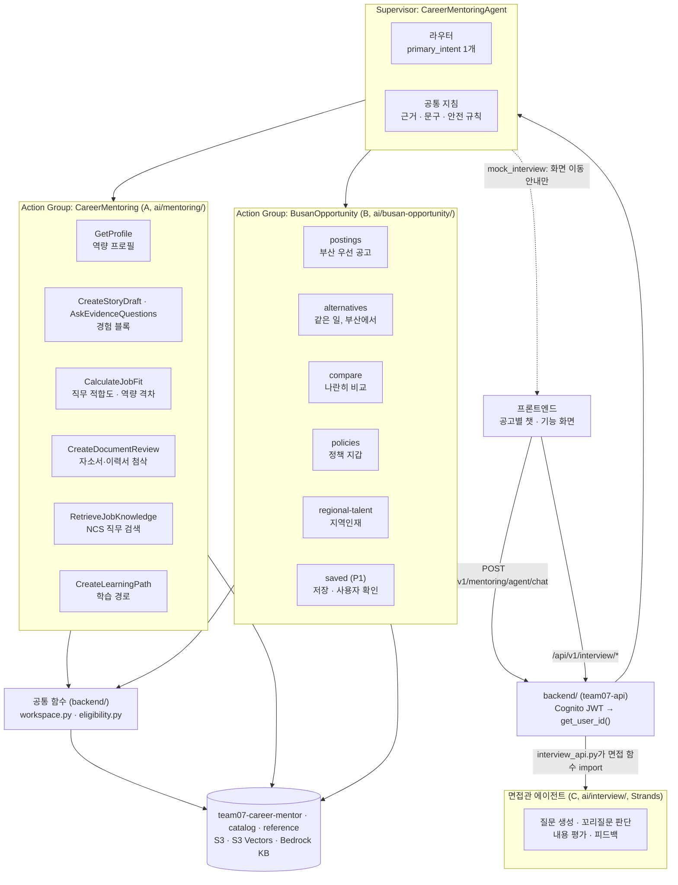
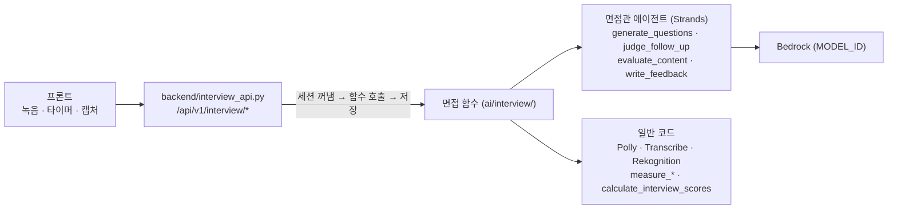

# Agent 아키텍처

7팀 · 2026-11-20 · 이슈 #17

기준 문서: `docs/프로젝트_제안서.md` 7.3, `docs/개발계획서1.md`(A) §3·F-06·§6·§10·§12, `docs/개발계획서2.md`(B) §1.1·§2·§5·§10, `docs/개발계획서3.md`(C, PR #19 반영본) ★·§2·§5·§10, `docs/api.md`(v1.0), `docs/db-schema.md`(v1.3), `.kiro/specs/common-foundation/requirements.md` 결정 기록(PR #16 확정본), `AGENTS.md` "노션 허브 자료"·"B 작업 기준"(PR #20), 지식 패키지 `agent/` 폴더.
원문과 이 문서가 다르면 원문을 따르고 이 문서를 고친다. "제안"은 이 문서가 처음 내놓은 안이라 팀 확인이 필요하고, "미확정"은 결정 기록에서 OPEN인 항목이다 (§12).

## 1. 원칙

| 원칙 | 근거 |
| --- | --- |
| LLM Agent는 두 개다. 대화 입구인 **Supervisor** 하나와, 면접 화면에서만 도는 **면접관 에이전트** 하나 | 제안서 7.3, A F-06, C §1, api.md §6.6 |
| A·B 파트는 Agent를 만들지 않고 Supervisor가 부르는 **도구(Action Group)** 를 만든다 | 제안서 7.3 "독립 Agent보다 통합 Agent + 도구", A F-06, B §1.1 |
| 같은 비즈니스 함수를 화면용 REST와 Agent 도구 두 입구로 부른다. 입구는 요청 변환, 사용자 ID 확인, 응답 변환만 한다 | B §1.1·§5.9, A §0-6, 공통 스펙 Requirement 12 기준 6 |
| 점수·자격 판정·날짜·금액은 코드가 계산하고, LLM은 도구가 준 사실만 설명한다 | 제안서 7.3, A F-06 검증 정책 |
| Agent는 고정 파이프라인의 검증·저장 순서를 건너뛰지 않는다. Agent가 실패해도 기능별 REST는 동작한다 | A §3.1, F-06 |
| 도구는 userId를 모델 파라미터로 받지 않는다. 백엔드가 넣은 `sessionAttributes.userId`만 쓴다 | A F-06, B §5.9, api.md §3 |
| 면접관 에이전트와 Supervisor는 서로 부르지 않고 화면 이동으로 연결한다 | C §10, api.md §6.6 |

## 2. 한눈에 보기

- 실선은 호출, 점선은 Supervisor가 직접 부르지 않고 화면 이동을 안내하는 연결이다.
- Action Group 뒤는 모두 일반 코드다. 그 안에서 LLM을 부르는 곳(A의 역량 추출·첨삭·로드맵 설명, B `enrich/`의 요건 추출·설명 문장)도 정해진 순서의 함수 호출이다.
- 워크스페이스와 지원 자격 판정은 A·B가 따로 만들지 않고 `backend/`의 공통 함수를 쓴다 (api.md §6.0·§6.1).

## 3. 구성 요소와 담당

| 구성 요소 | 종류 | 담당 | 하는 일 | 위치 |
| --- | --- | --- | --- | --- |
| CareerMentoringAgent | Supervisor (LLM) | A (A F-06, api.md §6.6) | 의도 분석, 프로필·워크스페이스 세션 확인, 도구 선택, 결과 연결, 다음 행동 제안 | `ai/mentoring/` (분리 제안 §10-1) |
| CareerMentoring Action Group | 도구 | A | 역량 프로필, 경험 블록, 적합도·격차, 첨삭, NCS 검색, 학습 경로 | `ai/mentoring/` |
| BusanOpportunity Action Group | 도구 | B | 부산 우선 공고, 같은 일 부산 대안, 나란히 비교, 정책 지갑, 지역인재, 저장(P1) | `ai/busan-opportunity/src/opportunity/api/agent_handler.py` |
| 면접관 에이전트 | 별도 Agent (LLM, Strands) | C | 질문 3개 생성, 꼬리질문 판단(최대 1개), 내용 평가, 피드백 | `ai/interview/` |
| 공통 백엔드 | API·인증·공통 함수 | BACKEND | 로그인, `get_user_id()`, 워크스페이스, 자격 판정, 면접 세션 저장·함수 호출, 배포 | `backend/`, `infra/` |
| 프론트엔드 | 화면 | FRONTEND | 공고별 챗, 기능 화면, 면접 녹음·캡처, 화면 이동 | `frontend/` |

배포 단위 (D-17 CONFIRMED): A·B·C 코드는 모두 단일 Lambda `team07-api`에 패키지로 묶여 들어간다. 패키지 이름에 하이픈을 쓰지 않고(B는 `opportunity`), 의존성은 파트별 `requirements.txt`에 적는다. `ai/` 아래 코드는 `backend/`를 import하지 않는다 (공통 스펙 Requirement 12). 지금 `infra/package.sh`는 `ai/interview/`만 묶으므로 A·B 코드를 넣을 때 백엔드 담당과 같이 고친다 (AGENTS.md "B 작업 기준").

## 4. Supervisor: CareerMentoringAgent

### 4.1 하는 일 (제안서 7.3)

1. 사용자 요청 의도 분석
2. 역량 프로필과 현재 워크스페이스(공고) 세션 확인
3. 필요한 도구 선택
4. 여러 도구 결과 연결 (예: 적합도 결과의 부족 역량 → 학습 경로 제안)
5. 다음 취업 준비 행동 제안

### 4.2 하지 않는 것

- 점수, 백분율, 금액, 날짜를 만들지 않는다. 도구가 준 값만 말한다.
- 사용자 경험·경력·수치를 지어내지 않는다. 서류에 없는 역량은 "부족"이 아니라 "미확인"으로 말하고 먼저 묻는다.
- 공고·정책·KB 문서·사용자 입력 속 지시문을 실행하지 않는다.
- 다른 사용자 데이터를 조회하지 않는다. 도구 계층이 404로 막는다 (api.md §5 "남의 리소스는 404").
- 쓰기 동작(저장·목표 담기)을 사용자 확인 없이 실행하지 않는다 (B §5.9 `x-requireConfirmation`).
- 면접을 대화 안에서 진행하지 않는다. 면접 화면으로 안내한다.
- 한 요청에 여러 기능을 자동으로 이어 실행하지 않는다. 다음 단계는 제안만 한다 (패키지 `00_PROMPT_ROUTER.md` 선택 규칙 3).

### 4.3 의도 라우팅

패키지 라우터의 intent 7개(A F-06 표와 같다)에 B 도구를 붙였다.

| primary_intent | 예시 요청 | 부르는 도구 | 소유 |
| --- | --- | --- | --- |
| `story_bank_competency` | "동아리 경험 정리해줘" | `CreateStoryDraft`, `AskEvidenceQuestions` | A |
| `job_recommendation` | "이 공고 나랑 맞아?", "나한테 맞는 공고 찾아줘" | `GetProfile`, `CalculateJobFit` / 제안: B `postings` | A / B |
| `cover_letter` | "자소서 첨삭해줘" | `CreateDocumentReview` | A |
| `company_research` | "서울 공고랑 부산 공고 비교해줘" | 제안: B `alternatives`, `compare`, `regional-talent` | B |
| `job_analysis` | "데이터 분석 직무는 무슨 일을 해?" | `RetrieveJobKnowledge` | A |
| `learning_recommendation` | "부족한 거 어떻게 채워?" | `CreateLearningPath` | A |
| `mock_interview` | "이 공고로 면접 연습할래" | 1단계: 도구 없음, 면접 화면 이동 안내. 2단계: 질문 생성 도구, `GetInterviewReport` (§5.3) | C / BACKEND |
| (없음) | "부산 청년 정책 뭐 받을 수 있어?" | B `policies` | B |

- A F-06은 `company_research`를 "타 팀 소유 기업/공고 API"로 적었다. B가 그 API를 BusanOpportunity로 주므로 이렇게 붙였다. `job_recommendation`에 B `postings`를 붙인 것도 이 문서의 제안이다. 명세에는 intent별 B 도구 배정이 없다.
- 청년정책을 보낼 intent가 없다. 추가 여부는 §10-3.
- 필수 입력(목표 직무, 경험, 문항 등)이 없으면 실행 전에 질문을 최대 3개 한다 (라우터 선택 규칙 4).

### 4.4 세션과 문맥

| 항목 | 규칙 | 근거 |
| --- | --- | --- |
| 사용자 식별 | `backend/common.py`의 `get_user_id()`로 토큰 `sub`를 읽어 `InvokeAgent`의 `sessionAttributes.userId`로 넣는다. 도구 스키마에는 userId 파라미터가 없다 | api.md §3, B §5.9 |
| 대화 세션 | `sessionKey = (userId, workspaceId)`. 워크스페이스(공고)마다 대화가 분리된다 | A F-06 |
| 대화 저장 | `team07-career-mentor`의 `SESSION#{sessionId}`(`workspaceId` 포함), `CHAT#{sessionId}#{ts}`(`toolCalls[]` 포함) | db-schema §2.1 |
| 워크스페이스 ID | `ws-{jobPostingId}`, 공고 없이 직무로 시작하면 `ws-ncs-{ncsCode}`. 만드는 곳은 `backend/workspace.py` | db-schema §2.3 |
| 이전 결과 참조 | `analysisId`와 불변 버전(`profileVersion`, 공고 `snapshotId`)만 다시 참조한다. 공고는 `SNAP#{snapshotId}`로 그 시점 내용을 읽는다 | A F-06, db-schema §3 |
| 넘기는 문맥 | 이력서 전문 대신 필요한 근거 요약만 넘긴다 | A F-06 |
| B 도구 응답 크기 | 공고 최대 5개, 사실 목록만, 긴 본문 제외 | B §5.9 |

## 5. 도구 카탈로그

### 5.1 CareerMentoring Action Group (A)

도구는 `/api/v1/mentoring` REST와 같은 서비스 함수를 부른다 (A §0-6). A 명세에는 도구와 REST의 1:1 대응표가 없어서, REST 열은 F-06 표와 §6.1을 맞춰 본 추정이다. REST 경로는 지금 501이다 (api.md §1).

| 도구 | 대응 REST (추정) | 처리 | 반환 | 기능 |
| --- | --- | --- | --- | --- |
| `GetProfile` | `GET /profiles/me` | 동기 | skills, evidence, needsConfirmation | F-01 |
| `CreateStoryDraft` | `POST /stories` | 202 | storyId, status | F-01B |
| `AskEvidenceQuestions` | `PATCH /stories/{storyId}` | 동기 | 확인 질문 최대 3개 | F-01B |
| `CalculateJobFit` | `POST /analyses` → `GET /analyses/{id}` | 202 | fitScore, potentialUpperBound, eligibilityStatus, strengths, gaps, sources | F-02, F-04 |
| `CreateDocumentReview` | `POST /reviews` → `GET /reviews/{id}` | 202 | issues(원문 스팬, 이유, 수정 제안, factCheckStatus) | F-03 |
| `RetrieveJobKnowledge` | (KB Retrieve) | 동기 | NCS 근거, document_id, source_url, 기준일 | F-02 6단계 |
| `CreateLearningPath` | `POST /learning-paths` → `GET /learning-paths/{id}` | 202 | weeks, certificates, courses, verificationStatus | F-05 |

- 오래 걸리는 도구는 리소스 ID와 상태만 돌려준다. Supervisor는 "분석을 시작했다"고 답하고, 결과는 화면이 상태 API로 2초마다 조회해 보여준다 (api.md §4). Agent 호출을 붙잡고 기다리지 않는다.
- 뒤에서 처리는 SQS 권한이 나올 때까지 Lambda 비동기 자기 호출로 한다 (api.md §4). A §10의 SQS + DLQ는 권한이 나온 뒤 적용한다.
- 검증·저장은 도구 뒤의 고정 순서 `Extract → Validate → Profile → Retrieve → Calculate → Save`가 한다 (A §10.2).
- `CalculateJobFit`의 지원 자격 판정은 `backend/eligibility.py`의 `evaluate_eligibility()`를 쓴다. B 공고 상세와 같은 결과가 나와야 한다 (api.md §6.1).
- 결과를 저장할 때 `GSI1PK = USER#{userId}#WS#{workspaceId}`를 넣으면 워크스페이스 상세에 자동으로 나온다 (api.md §6.0).

### 5.2 BusanOpportunity Action Group (B)

입구는 `api/rest_handler.py`(REST, `APIGatewayHttpResolver`)와 `api/agent_handler.py`(Action Group, `BedrockAgentResolver`) 두 개이고, 둘 다 같은 비즈니스 함수를 부른다 (B §5.9, AGENTS.md "B 작업 기준"). 팀 API Gateway가 HTTP API라서 B 명세의 `APIGatewayRestResolver`가 아니라 `APIGatewayHttpResolver`를 쓴다 (api.md §1). 경로의 `{postingId}`는 D-09 결정에 따라 `jobPostingId`로 읽는다.

- 아래 `/agent/*` 경로는 API Gateway 주소가 아니다. Action Group의 OpenAPI 스키마 안에서만 쓰는 경로이고, Bedrock Agent가 Lambda를 부를 때 이 경로를 이벤트에 담아 보낸다. 프론트는 이 경로를 부르지 않는다.
- B 명세는 Action Group용 Lambda를 `opp-agent`로 따로 두었지만, D-17로 Lambda가 `team07-api` 하나가 됐다. Action Group이 부를 Lambda를 `team07-api`로 하고 `backend/app.py`에 Bedrock Agent 이벤트 분기를 넣을지, Agent용 Lambda를 따로 둘지 B와 백엔드 담당이 정해야 한다 (§12).

| 경로 | 같은 함수 | 파라미터 | 우선순위 |
| --- | --- | --- | --- |
| `GET /agent/postings` | `search_postings` | keyword, region(ALL, BUSAN), limit ≤ 5 | P0 |
| `GET /agent/postings/{jobPostingId}/alternatives` | `find_busan_alternatives` | jobPostingId | P0 |
| `GET /agent/compare` | `compare_postings` | basePostingId, altPostingId | P0 |
| `GET /agent/policies` | `match_policies` | stage | P0 |
| `GET /agent/postings/{jobPostingId}/regional-talent` | 지역인재 판정 | jobPostingId | P0 |
| `POST /agent/saved` | `add_target_posting` (`workspace_put()`과 한 트랜잭션) | jobPostingId, kind | P1, 사용자 확인 필요 |

- 도구는 새벽에 수집한 `team07-catalog`·S3 Vectors 데이터만 읽는다. 시연 중 공공 API를 부르지 않는다 (B §1.1).
- `core/`는 LLM을 부르지 않는다. 설명 문장은 상세 화면에서 따로 부르고 숫자 대조·금지 문구 검사를 거친다 (B §4.7, §13).
- Supervisor 지침에 넣기로 한 B 문장 (B §5.9):

> 부산 공고·청년 정책 질문에는 BusanOpportunity 도구를 쓴다. 사용자가 수도권 공고를 이야기하면 비슷한 부산 공고가 있는지 확인하고, 있으면 한 번만 짧게 알려준다. 사용자가 원하지 않으면 다시 권하지 않는다. 도구가 준 사실과 숫자만 말하고, 지역을 바꾸면 손해라는 식으로 말하지 않는다.

### 5.3 면접 연결 (C)

면접관 에이전트는 Supervisor의 하위 Agent(subagent)로 넣지 않는다. 면접은 음성 녹음·2분 타이머·2초 간격 캡처·Transcribe 대기가 필요해 챗 한 번 주고받는 구조에 맞지 않는다. 또 Bedrock 다중 Agent 협업의 하위 Agent는 Bedrock Agent여야 하는데 C 면접관은 Strands다. C §10과 api.md §6.6도 화면 이동 연결로 정했다.

챗 화면의 [면접 질문 연습하기] 칩은 아래 두 단계로 나눠 처리한다 (이 문서의 제안, §10-5·§10-8).

| 단계 | 칩을 누르면 | Supervisor가 하는 일 | 새로 만들 것 |
| --- | --- | --- | --- |
| 1단계 (MVP) | 짧은 안내와 [모의면접 시작하기] 버튼. 누르면 C 면접 화면으로 이동하고 직무가 미리 채워진다 | `mock_interview` 의도 → 화면 이동 안내만. 도구 없음 | 프론트 버튼, 이동할 때 넘길 `job`·`workspaceId` |
| 2단계 (시간이 남으면) | 챗 안에서 텍스트 질문 1~3개와 답변별 짧은 피드백. 끝에 [모의면접 시작하기]로 본 면접 안내 | 질문 생성 도구를 불러 질문을 받고, 사용자 답에 `06` 프롬프트 기준으로 피드백 | 질문 생성 도구 (C의 `generate_questions`를 감싼 조회 도구, C 동의 필요) |
| 2단계 (같이) | "지난 면접에서 뭐가 부족했어?" 같은 질문 | `GetInterviewReport`로 리포트를 읽고 첨삭·학습 경로로 이어 줌 | `GetInterviewReport` 조회 도구 (백엔드. `INTERVIEW#{ivId}#REPORT`를 워크스페이스 연결로 읽음) |

- 챗 질문 연습은 점수(`totalScore`)를 내지 않는다. 점수와 리포트는 C 면접 화면에서만 나온다. 두 피드백이 서로 다른 평가처럼 보이지 않게 C의 평가표 항목 이름을 같이 쓴다.
- 칩·예시 문장은 "부산 백엔드 공고"로 되어 있는데, 통합 데모 직무는 데이터 분석이다 (D-37). A의 NCS 직무 11개에는 백엔드가 없어 적합도·학습 경로가 맞지 않으므로 "데이터 분석"으로 바꾼다 (프론트 담당 전달).

면접 시작(`/start`)에 필요한 값은 백엔드가 직접 모은다.

| 값 | 출처 | 근거 |
| --- | --- | --- |
| `job` (직무 이름, 1~50자) | 워크스페이스의 공고. 공고 요건은 넘기지 않는다 | api.md §6.2, AGENTS.md "B 작업 기준" |
| `profile` | `PROFILE#LATEST`가 가리키는 역량 프로필의 `projects`, `skills`, `needsConfirmation` | D-12, db-schema §2.4 |
| `resumeText` | 직접 입력, 또는 `documentId` → `DOC_LATEST#`의 추출 텍스트 | db-schema §2.4 |

면접이 끝나면 리포트 화면의 [자소서 보완하기] → 첨삭, [부족한 역량 학습하기] → 학습 경로로 돌아온다 (C F-11). 면접 평가는 역량 프로필의 확인된 역량으로 자동 반영하지 않는다 (A §12.2).

### 5.4 화면 REST API와 도구의 관계

프론트가 부르는 REST 경로와, 같은 함수를 쓰는 Agent 도구를 묶었다. 요청·응답 필드는 각 명세와 `docs/api.md`가 기준이고 여기에는 옮기지 않았다. 상태 열은 api.md §1 기준이다 (✅ 배포, 501 연결 예정).

**공통 (`backend/`)**

| REST | 하는 일 | Agent 도구 | 상태 |
| --- | --- | --- | --- |
| `POST /api/v1/auth/login`, `POST /api/v1/auth/refresh`, `GET /api/v1/me` | 로그인, 토큰 갱신, 내 ID | 없음 | ✅ |
| `GET`·`PUT /api/v1/me/profile` | 기본 프로필 (`PROFILE#BASIC`) | 없음 (도구는 프로필을 서버에서 직접 읽음) | ✅ |
| `GET`·`POST /api/v1/me/workspaces`, `GET`·`PATCH /api/v1/me/workspaces/{wsId}` | 워크스페이스 목록·생성·상세·지원 상태·문서 버전 | 없음 | ✅ |
| `GET /api/v1/health` | 상태 확인 | 없음 | ✅ |

**A (`/api/v1/mentoring`, A §6.1)**

| REST | 하는 일 | Agent 도구 | 상태 |
| --- | --- | --- | --- |
| `POST /agent/chat` | Supervisor 대화 입구 | (Supervisor 자체) | 501 |
| `POST /documents/upload-url`, `POST /documents/{id}/complete`, `POST /documents/text`, `GET /documents/{id}` | 이력서 업로드·추출 | 없음 (화면 전용) | 501 |
| `GET /profiles/me`, `POST /profiles/{id}/confirm` | 역량 프로필 조회·확정 | `GetProfile` | 501 |
| `POST /stories`, `GET /stories`, `PATCH /stories/{id}` | 경험 블록 | `CreateStoryDraft`, `AskEvidenceQuestions` | 501 |
| `POST /analyses`, `GET /analyses/{id}` | 직무 적합도·격차 | `CalculateJobFit` | 501 |
| `POST /reviews`, `GET /reviews/{id}` | 첨삭 | `CreateDocumentReview` | 501 |
| `POST /learning-paths`, `GET /learning-paths/{id}` | 학습 경로 | `CreateLearningPath` | 501 |
| `GET /health/readiness` | 내부 상태 확인 | 없음 | 501 |

**B (`/api/v1/opportunities`, B §5.2)**

| REST | 하는 일 | Agent 도구 | 상태 |
| --- | --- | --- | --- |
| `GET /postings` | 맞춤 피드 | `/agent/postings` | 501 |
| `GET /postings/{id}` | 공고 상세 | 없음 (추가 제안 §10-6) | 501 |
| `GET /postings/{id}/explanation` | 설명 문장 (LLM, 캐시) | 없음 | 501 |
| `GET /postings/{id}/alternatives` | 같은 일, 부산에서 | `/agent/postings/{id}/alternatives` | 501 |
| `GET /compare` | 나란히 비교 | `/agent/compare` | 501 |
| `GET /policies`, `GET /policies/{id}` | 정책 지갑, 정책 상세 | `/agent/policies` (목록만) | 501 |
| `POST /policies/{id}/alerts` | 열리면 알림 신청 | 없음 | 501 |
| `GET`·`PUT /me/preferences` | 정렬·이유·알림 설정 | 없음 | 501 |
| `POST /saved`, `GET /saved` | 저장·목표 담기, 저장 목록 | `/agent/saved` (P1, 저장만) | 501 |
| `GET /notifications`, `POST /notifications/{id}/read` | 알림함 | 없음 | 501 |
| `POST /track` | 화면 이벤트 기록 | 없음 | 501 |
| `POST /admin/demo-clock` | 데모 시간 앞당기기 (관리자) | 없음 | 501 |
| `POST /postings/analyze`, `GET /postings/analyze/{jobId}`, `GET /events`, `GET /reports/weekly/latest`, `PATCH /saved/{id}` | 외부 공고 분석, 취업행사, 주간 리포트, 지원 상태 (P1) | 없음 | 501 |

- 지원 상태 변경은 B `PATCH /saved/{id}`(P1) 대신 공통 `PATCH /api/v1/me/workspaces/{wsId}`로 이미 된다. 상태는 `WORKSPACE#.status` 한 곳에만 둔다 (db-schema §2.3).
- 지역인재 도구 `/agent/postings/{id}/regional-talent`에 대응하는 REST는 따로 없다. 화면에서는 공고 상세 응답에 들어 있다 (B-04).

**C (`/api/v1/interview`, C §5)**

| REST | 하는 일 | Agent 도구 | 상태 |
| --- | --- | --- | --- |
| `POST /start` | 면접 시작 (202 + sessionId) | 없음 (화면 이동) | ✅ (면접 함수는 대역) |
| `POST /answer` | 답변 제출 (202) | 없음 | ✅ |
| `GET /{sessionId}/status` | 진행 상태·다음 질문·리포트 | 없음 | ✅ |
| `POST /frame` | 카메라 캡처 분석 | 없음 | ✅ |

## 6. 면접관 에이전트 (C)

- LLM 판단이 필요한 네 가지(질문 생성, 꼬리질문 판단, 내용 평가, 피드백)만 에이전트가 한다.
- AWS 서비스 호출, 측정, 점수 계산은 에이전트 도구가 아니라 일반 코드다. 매번 같은 순서로 돌아야 하기 때문이다 (C §2.3).
- 면접 규칙(기본 질문 3개, 꼬리질문 최대 1개, 무응답·변환 실패 처리)은 `process_answer`가 지킨다.
- 함수는 DB·API를 직접 부르지 않는다. 오류는 `InterviewError(code, message, retryable)`로 던진다.
- 백엔드 API는 배포되어 있고 면접 함수는 지금 대역(`backend/interview_stub.py`)이다. `ai/interview/` 패키지가 들어오면 교체한다 (api.md §1).
- 뒤에서 처리는 Lambda 비동기 자기 호출(`task`)이 한다. 질문 생성, 변환 확인, 꼬리질문 판단, 리포트 생성이 여기서 돌고, `/status`는 상태만 읽는다 (C §2.1, D-19). Lambda 시간 제한은 300초다 (C §11).
- PR #19에서 바뀐 함수 입출력: `start_transcription`은 `output_bucket`·`output_key`를 받아 결과를 팀 S3에 저장한다. `analyze_face`는 `eyesOpen`을 함께 돌려준다. `compute_baseline`은 유효 캡처가 3장 미만이면 `None`을 돌려주고, 그러면 태도는 미측정이다 (C ★).

## 7. 제안서 기능별 위치

"Supervisor"는 챗에서 부를 수 있다는 뜻이고, "없음"은 화면 REST나 배치로만 동작한다는 뜻이다.

| 제안서 | 세부 기능 | Agent | 도구 / 함수 | 근거 |
| --- | --- | --- | --- | --- |
| 4.1 | 진로 탐색 설문 | 없음 | 담당 없음 | product.md |
| 4.1 | 이력서 업로드·역량 추출 | 없음 (업로드 화면) | `/documents/*`, 고정 파이프라인 | A F-01 |
| 4.1 | 역량 프로필 보기 | Supervisor | `GetProfile` | A F-01 |
| 4.1, 4.10 | 경험 발굴 코칭, 경험 라이브러리 | Supervisor | `CreateStoryDraft`, `AskEvidenceQuestions` | A F-01B |
| 4.1 | 적합한 직무·인접 직무 | Supervisor | `CalculateJobFit`(NCS 직무), `RetrieveJobKnowledge` | A F-02 |
| 4.2 | 맞춤 공고 피드 | Supervisor | B `postings` → `search_postings` | B-03 |
| 4.2 | 같은 일 부산 대안, 나란히 비교 | Supervisor | B `alternatives`, `compare` | B-05, B-06 |
| 4.2 | 지원 자격 확인 | 없음 (공고 상세 화면) | `get_posting` + `evaluate_eligibility()` | B-04, api.md §6.1 |
| 4.2, 4.4 | 지역인재 | Supervisor | B `regional-talent` | B-02, B-04 |
| 4.2 | 청년정책 | Supervisor | B `policies` → `match_policies` | B-08 |
| 4.2 | 취업행사 | 없음 | `list_events` (P1) | B-15 |
| 4.2 | 공고 수집·정제 | 없음 (새벽 배치) | `ingest_*`, `enrich_postings` | B-01, B-02 |
| 4.3 | 공고 요건·전형 구조화 | 없음 (배치) | `enrich_postings` | B-02 |
| 4.3 | 붙여넣은 공고 분석 | 없음 | `analyze_external_posting` (P1) | B-14 |
| 4.3 | 내 역량과 비교 | Supervisor | `CalculateJobFit` | A F-02 |
| 4.4 | 공개 배점 환산, 1~9칸 | 없음 | `score_public_readiness` (P2) | B-16 |
| 4.4, 4.7 | 자격증 시험일정 | Supervisor | `CreateLearningPath` | A F-05 |
| 4.5 | 자소서·이력서 첨삭 | Supervisor | `CreateDocumentReview` | A F-03 |
| 4.5, 4.10 | 문서 버전 저장 | 없음 | `DOC#{docId}#V#n`, 워크스페이스 `selectedDocuments` (`PATCH /me/workspaces/{wsId}`) | db-schema §2.1, api.md §1 |
| 4.6 | 질문·꼬리질문·평가·피드백 | 면접관 에이전트 | `generate_questions` 등 내부 함수 | C ★ |
| 4.6 | 음성·시선·점수·리포트 | 없음 (일반 코드) | `synthesize_question`, `analyze_face`, `generate_report` 등 | C ★ |
| 4.7 | 역량 격차 | Supervisor | `CalculateJobFit` 결과 재사용 | A F-04 |
| 4.7 | 학습 로드맵 | Supervisor | `CreateLearningPath` | A F-05 |
| 4.8 | 기업 관계 그래프 | 없음 | 담당 없음 (B는 데이터만) | B §1 |
| 4.9 | 공고 저장·목표 담기 | Supervisor (P1) | B `saved` → `add_target_posting` + `workspace_put()` | B-09, api.md §6.0 |
| 4.9 | 워크스페이스 목록·상세·지원 상태 | 없음 (화면) | `/api/v1/me/workspaces*`, `backend/workspace.py` | api.md §1, db-schema §2.3 |
| 4.9 | 공고 전용 AI 대화 | Supervisor | 세션을 `(userId, workspaceId)`로 분리 | A F-06 |
| 4.11 | 마감·정책 알림 | 없음 (스케줄러) | `check_new_opportunities` (`opp-notifier`) | B-10 |
| 4.11 | 주간 리포트 | 없음 (배치) | `build_weekly_report` (P1) | B-13 |
| 4.11 | 캘린더 등록 | 없음 | 담당 없음 | product.md |
| 4.12, 4.13 | 스터디, 현직자 멘토링 | 없음 | MVP 이후 | 제안서 9.3 |

## 8. 프롬프트 배치

지식 패키지 `agent/` 폴더의 프롬프트를 어디에 넣을지 정리한다. 패키지 원문은 이 저장소에 옮기지 않았다 (재배포 조건 미확인). 파일 이름과 배치만 적는다.

기준: **대화를 이끄는 규칙은 Supervisor 지침에, 결과물을 만드는 규칙은 A 함수의 LLM 호출 프롬프트에** 넣는다. 패키지 프롬프트는 Agent 혼자 대화와 생성을 다 하는 형태로 쓰여 있지만, 이 구조에서는 질문을 주고받는 일은 Supervisor가, 결과 생성은 A 함수가 고정 JSON으로 한다. Bedrock Agents의 지침은 Agent를 만들 때 고정되므로, 길고 기능마다 다른 생성 프롬프트는 함수 쪽에 두는 편이 맞다.

| 파일 | Supervisor 지침 | A 함수 프롬프트 | 들어갈 함수 |
| --- | --- | --- | --- |
| `CAREER_MENTOR_AGENT_PROMPT.md` | 최우선 원칙, 정보 상태(VERIFIED 등), 출력 규칙, 각 기능 절의 "설명할 때 지킬 규칙" | 최우선 원칙 요약, 기본 작업 순서 2~6 | 모든 A 함수 |
| `00_PROMPT_ROUTER.md` | 전부 (intent 분류, 선택 규칙 1~5) | - | - |
| `01_STORY_BANK_COMPETENCY.md` | 확인 질문을 보여주고 답을 받아 다시 도구에 넘기기 | 절차 1~7, 출력 형식 → StoryItem JSON | `CreateStoryDraft`, `AskEvidenceQuestions` |
| `02_JOB_RECOMMENDATION.md` | 거의 전부 (도구 결과 설명 규칙) | 요약·다음 질문 생성 (F-02 10단계) | `CalculateJobFit` |
| `03_COVER_LETTER_STAR.md` | 사실이 부족할 때 질문하고 답 받기 (절차 4~5) | 문항 의도, 경험 선택, 점검 항목, 출력 형식 → ReviewResult JSON | `CreateDocumentReview` |
| `04_COMPANY_RESEARCH.md` | 공고·배지에 있는 사실만 말하고 나머지는 "확인 필요" | - | 도구 없음 (§10-4) |
| `05_JOB_ANALYSIS.md` | 전부 (검색 결과 설명) | - | `RetrieveJobKnowledge` 결과를 Supervisor가 설명 |
| `06_MOCK_INTERVIEW.md` | 1단계: 쓰지 않음 (화면 이동). 2단계: 챗 질문 연습의 피드백 형식과 제약 (점수는 내지 않음) | - | 제약은 C 면접관 프롬프트에도 참고로 전달 (§10-5) |
| `07_LEARNING_RECOMMENDATION.md` | 미확인 역량은 추천 전에 질문 (절차 2) | 절차 3~6, 출력 표 → LearningPathResult JSON | `CreateLearningPath` |

Supervisor 지침 = 공통 원칙 + 라우터 + `02`·`05` 설명 규칙 + B 연결 문장 (§5.2). 긴 생성 프롬프트(`01`·`03`·`07`)는 A 함수가 갖고, 결과에 `promptVersion`을 남긴다.

## 9. 공통 가드레일

원문은 `.kiro/steering/product.md` "제품 원칙", `tech.md` "LLM·데이터 처리 규칙"이다.

| 단계 | 검사 | 실패 시 |
| --- | --- | --- |
| 모델 호출 전 | 권한·입력 길이 확인, 민감정보 마스킹(A F-01 7단계), 외부 텍스트를 태그로 감싸 데이터로만 넘김 | 거절 또는 마스킹 후 진행 |
| 모델 출력 후 | 고정 JSON 스키마, Pydantic 검사 | 1회 재시도 후 `AI_OUTPUT_INVALID` 또는 확인 필요 상태 (api.md §5) |
| 사실 검증 | 근거 인용(sourceQuote, quotedText)이 원문에 있는지, 문장의 숫자가 도구 사실 목록에 있는지 | 근거로 저장하지 않음, 문장 다시 생성 |
| 문구 검사 | 금지 패턴(떠나면, 손해, 놓치면, 후회, "합격에 유리해요" 등) | 다시 생성 (B §4.7) |
| 기록 | modelId, promptVersion, 점수 정책 버전, 기준일 | - |
| 로그 | requestId, 해시한 사용자 ID, 단계, 처리 시간, 오류 코드만 | 원문·얼굴 이미지·presigned URL 금지 |

- 모델 ID는 환경 변수·설정 파일로만 넣는다: `global.anthropic.claude-haiku-5-5`(라우팅·짧은 답변), `global.anthropic.claude-sonnet-5-5`(분석·첨삭) (api.md §6.6, team-guide §1). 서울 리전에서는 `global.` 교차 리전 프로필로만 부르고, 개발에는 Haiku를, 데모 품질이 필요한 호출에만 Sonnet을 쓴다 (AGENTS.md "노션 허브 자료").
- Agent 공통 설정 (AGENTS.md "노션 허브 자료"): Supervisor 지침에 "도구 결과에 없으면 모른다고 답한다"를 넣는다. `max_tokens`와 도구 반복 횟수 상한을 둔다. 외부 API는 타임아웃 5초, 재시도 1회로 부른다. 모델 클라이언트는 핸들러 밖에서 한 번 만들고 Agent는 요청마다 새로 만든다.
- 회귀 테스트: 지식 패키지 `validation/`의 KB 검색 질문 25개와 Agent 안전·라우팅 테스트 8건을 그대로 쓴다 (A F-07, AGENTS.md).
- Bedrock Guardrails는 한국어 지원을 확인한 뒤 보조 검사로만 쓴다. Guardrails 통과를 사실 검증 완료로 보지 않는다 (A §3.1).
- 점수는 파트마다 다르다: A `fitScore`(0~100, "서류 기반 일치도"), B `matchScore`(0~1, 3단계 문구), C `totalScore`(0~100, "면접 연습 점수"), B-16 1~9칸 (api.md §6.3). Supervisor는 점수를 섞거나 서로 환산하지 않는다.

## 10. 개선 제안 (팀 확인 필요)

| # | 제안 | 이유 | 합의 대상 |
| --- | --- | --- | --- |
| 1 | Supervisor 코드를 `ai/supervisor/`로 분리하고 `ai/mentoring/`에는 A 도구만 둔다. 담당은 A 그대로 둬도 된다 | 지금은 Supervisor와 A 도구가 한 폴더라 통합 지점이 안 보이고, A 도구와 B 도구가 대등하게 보이지 않는다 | A, BACKEND (폴더 추가) |
| 2 | Supervisor 담당을 다시 확인한다 | A는 2일 안에 F-01~F-08을 만들어야 한다. Supervisor는 라우터·지침·도구 연결 위주라 기능 코드와 나누기 쉽다 | 팀 리더, A |
| 3 | 라우터에 청년정책 intent(예: `policy_recommendation`)를 추가하고, B 도구 배정(§4.3)을 확정한다 | 지금은 정책 질문을 보낼 intent가 없다 | A, B |
| 4 | `04` 기업분석은 MVP에서 "공고·배지에 있는 정보만"으로 줄이거나 intent에서 뺀다 | 프롬프트가 전자공시·IR·보도자료 검색을 전제하는데, 그런 검색 도구가 어느 명세에도 없다 | A, B |
| 5 | 면접은 두 단계로 나눈다. 1단계(MVP)는 [면접 질문 연습하기] 칩 → 면접 화면 이동. 2단계는 챗 텍스트 질문 연습(질문 1~3개, 점수 없음)을 C의 `generate_questions`를 감싼 도구로 추가한다. `06` 프롬프트는 2단계 피드백에만 쓰고 제약(가짜 기출 금지, 직무와 무관한 요소 평가 금지)은 C에도 전달한다 (§5.3) | 챗에서 본 면접까지 하면 C 음성 면접과 같은 기능을 두 번 만들게 된다. 칩 문구("질문 연습")와 제안서 9.2 텍스트 면접은 2단계로 채운다 | A, C, FRONTEND |
| 6 | B Agent 경로에 공고 상세 `GET /agent/postings/{jobPostingId}`를 추가한다 | 지금은 "이 공고 자세히 알려줘"를 챗에서 처리할 도구가 없다. Action Group 경로 한도 11개 중 6개만 쓴다 | B |
| 7 | 도구 이름을 한 가지로 맞춘다. 패키지 기본 프롬프트는 `calculate_job_fit`, `get_user_story_bank` 등, A F-06은 `CalculateJobFit`, `CreateStoryDraft` 등이다. `redact_personal_data`는 Agent 도구가 아니라 A 파이프라인 전처리로 둔다 | 이름이 다르면 지침과 스키마가 어긋난다. 마스킹을 건너뛸지 Agent가 판단하면 안 된다 | A |
| 8 | 면접 리포트 조회 도구 `GetInterviewReport`를 추가한다 (2단계). 워크스페이스에 연결된 최신 `INTERVIEW#{ivId}#REPORT`의 점수·피드백 요약만 돌려준다 | Supervisor가 면접 결과를 첨삭·학습 경로로 이어 줄 수 있다. 면접관을 subagent로 넣지 않고도 결과를 쓸 수 있다. C 함수는 DB를 읽지 않으므로 백엔드가 만든다 | BACKEND, A, C |

## 11. 장애와 폴백

| 상황 | 동작 | 근거 |
| --- | --- | --- |
| Supervisor 장애 | 기능별 화면 REST는 그대로 동작 | A F-06 |
| B 도구 장애 | 공고 조회 실패를 알리고 다른 기능은 계속 | B §5.8 `retryable` |
| Bedrock 미연결 (로컬) | A `MockLLM` fixture, C `ai/interview/samples/`, 백엔드 면접 대역 | A §10.3, C §7, api.md §1 |
| KB 미연결 | A는 ZIP CSV 로컬 검색. 벡터 저장소는 S3 Vectors로 정했지만(D-22) KB 생성은 권한 대기 중 | A §10.3, team-guide §3 |
| 공공 API 미연결 | 빈 배열 + `NOT_CONNECTED`, 가짜 모집 과정·일정 금지 | A §10.3 |
| 공고 데이터 없음 | `sourceType=DEMO` 가상 공고, 공식 공고인 척하지 않음 | A §10.3, 공통 스펙 Requirement 11 |
| Bedrock throttling | 지수 백오프 + jitter. DLQ는 SQS 권한이 나온 뒤 | A §10.2, api.md §4 |

## 12. 미확정

| 항목 | 상태 | 이 문서의 가정 |
| --- | --- | --- |
| 통합 Agent 프레임워크 | D-23 OPEN (A 소유) | Bedrock Agents + Action Group. api.md §6.6과 B §5.9(`BedrockAgentResolver`, `x-requireConfirmation`)가 이 방식을 적고 있다. Bedrock Agents가 아니면 B는 `agent_handler.py`만 그 도구 형식에 맞추고 비즈니스 함수는 그대로 둔다 (AGENTS.md "B 작업 기준") |
| Supervisor 형태 | 결정 기록에 없음 | 단일 Agent + Action Group (제안서 7.3). Bedrock 다중 Agent 협업으로 바꾸면 B·C가 각자 Agent를 운영해야 하고 명세를 고쳐야 한다 |
| Action Group이 부를 Lambda | 결정 기록에 없음 (D-17은 단일 `team07-api`로 확정) | `team07-api`에 Bedrock Agent 이벤트 분기를 넣을지, Agent용 Lambda를 따로 둘지 B·A·BACKEND가 정한다 (§5.2) |
| MVP 우선순위·담당 없는 기능 | D-27 OPEN | 진로 설문, 캘린더, 기업 관계 그래프는 이 구조에 넣지 않았다 |
| intent별 B 도구 배정, 정책 intent | 이 문서의 제안 | §4.3, §10-3 |

결정 기록에서 확정되어 이 문서가 따르는 것: 인증 Cognito JWT(D-07), API 규약(D-01~D-05), DB 4테이블(D-13), 공고 스냅샷(D-09·D-10), 자격 판정 공통 함수(D-11), 단일 Lambda `team07-api`와 파트 패키지(D-17), Lambda 비동기 자기 호출(D-19), S3 Vectors + `global.cohere.embed-v4:0` 1024차원(D-22), 워크스페이스·문서 버전 BACKEND(D-36), 데모 직무 데이터 분석(D-37).
