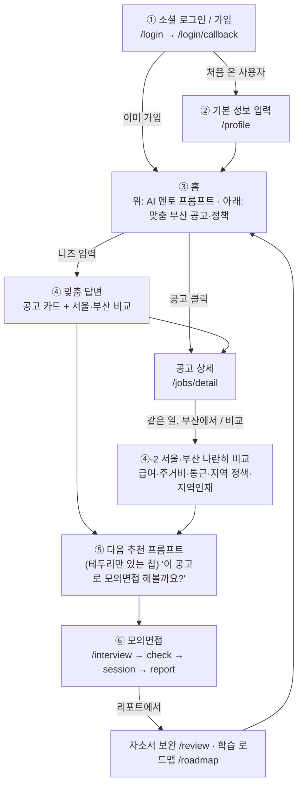

# 사용자 흐름 (부산커리어)

> 팀 논의(2026-11-20)에서 정한 큰 흐름을, 배포된 화면(`frontend/`, CloudFront)과 각 파트 API에 맞춰 다듬었다.
> 화면 경로는 `frontend/src/app/`, API는 `docs/api.md`, 결정 기록은 `.kiro/specs/common-foundation/requirements.md` 기준이다.
> 각 단계의 "지금 상태"는 2026-11-20 저녁 main 기준이다.

## 0. 한눈에 보기

핵심 흐름은 **로그인 → 정보 입력 → 니즈 질문 → 공고 + 지역 비교 → 모의면접**이다.
GNB 탭(홈, 채용·정책, AI 모의면접, 이력서·직무 진단, AI 서류 첨삭, 학습 로드맵)으로 언제든 다른 기능으로 바로 갈 수 있다.

---

## ① 소셜 계정으로 가입·로그인

| 항목 | 내용 |
| --- | --- |
| 화면 | `/login` → (Google·카카오) → `/login/callback` |
| 문구 | "간편하게 로그인하고 나에게 맞는 공고와 정책을 받아 보세요." / "이름과 이메일은 받지 않아요." |
| 동작 | 버튼 → `POST /api/v1/auth/social/start` → Cognito → 제공자 → 콜백에서 `POST /api/v1/auth/social/token` |
| 분기 | 로그인 후 `PROFILE#BASIC`이 없으면 `/profile`로, 있으면 원래 가려던 화면(`?next=`)으로 |
| 시연용 | `/login/demo`: 데모 계정 `demo1`~`demo3` (아이디·비밀번호 로그인) |

- 처음 소셜 로그인하면 Cognito가 계정을 만든다. "가입"을 따로 두지 않고 **첫 로그인 = 가입**으로 본다.
- 제공자에게는 `openid`만 요청한다. 이름·이메일·전화번호를 받지 않고 저장하지 않는다.
- 지금 상태: Google만 설정됨(#103). 카카오는 클라이언트 ID·비밀값 등록 전이다.

## ② 가입할 때 사용자 정보 입력

| 항목 | 내용 |
| --- | --- |
| 화면 | `/profile` ("기본 정보") |
| 입력 | 출생 연도, 지금 상태(취업 상태), 사는 지역(시·도), 구·군(부산일 때), 최종 학력, 졸업 상태(선택), 전공(선택), 희망 분야, 희망 직무(선택) |
| 저장 | `PUT /api/v1/me/profile` → `team07-career-mentor` `PROFILE#BASIC` |
| 다음 | 저장하면 홈(또는 `?next=` 주소)으로 |

- 이 정보는 **공고 추천 순서와 정책 자격 판정**(`backend/eligibility.py`)에 쓴다. 화면에도 "공고 추천과 정책 자격 판정에 쓰는 정보예요"라고 밝힌다.
- 이력서·자기소개서는 여기서 받지 않는다. 처음 입력을 가볍게 하려고, ④·⑥ 단계에서 필요할 때 받는다.
- 정리할 점: 전공·희망 직무를 비워 두면 추천 품질이 떨어진다. 홈 상단에 "희망 직무를 넣으면 더 잘 맞는 공고를 보여드려요" 같은 안내를 한 줄 두는 것을 제안한다.

## ③ 홈: 위는 니즈 프롬프트, 아래는 맞춤 추천

| 영역 | 내용 | 데이터 |
| --- | --- | --- |
| 위: "AI 멘토에게 물어보기" | 프롬프트 입력칸 + 예시 질문 칩 ("부산 데이터 분석 공고 찾기", "청년 지원 정책 알아보기", "면접 질문 연습하기") | 채팅 Agent (D-38, Strands, `POST /api/v1/agent/chat`, `docs/개발계획서4.md`) |
| 오른쪽: "이어서 하기" | 진행 중인 진단·첨삭·면접 등 | 워크스페이스 |
| 아래: "나와 맞는 부산 공고" | ②의 정보로 고른 공고 3건 → "전체 보기" `/jobs` | `GET /api/v1/opportunities/postings` |
| 아래: "부산 청년 지원 정책" | 받을 수 있는 정책 3건 → `/policies` | `GET /api/v1/opportunities/policies` |

- 사용자가 아무것도 묻지 않아도 아래 추천만으로 쓸 수 있어야 한다. 프롬프트는 "더 좁혀서 찾기" 역할이다.
- 적합도는 숫자 없이 "잘 맞아요 / 맞는 편이에요 / 조금 맞아요"로만 보여주고 "합격 확률이 아니에요"를 함께 둔다.
- 프롬프트 입력칸에 이력서·자기소개서 PDF를 붙일 수 있다 (클립 버튼·끌어다 놓기, PDF 1개 10MB 이하, #127). 이력서인지 자기소개서인지 고르면 A 문서로 올리고, Agent가 그 서류로 공고를 찾고 진단·첨삭·면접으로 이어 준다 (#122).
- 지금 상태: 아래 공고·정책은 실제 B API에 연결됨(#120). 위 프롬프트는 채팅 Agent에 연결됨(#122). PDF·붙여넣은 이력서는 A 문서로 저장한 뒤 역량 요약을 Agent 문맥으로 쓴다. 공고는 공식 데이터에서 먼저 찾고 없으면 팀 데이터에서 찾아 표시한다.

## ④ 니즈 입력 → 맞춤 공고 + 서울·부산 비교

예: "부산에서 데이터 분석 신입으로 일하고 싶은데, 서울이랑 비교하면 어때?"

**답변 구성 (대화 화면)**
1. 짧은 요약 한두 문장 (도구가 준 사실만)
2. **공고 카드** 최대 5건: 기업, 공고명, 근무지, 마감(D-n), 급여, 적합도 3단계, 배지(출처·기준일) → [공고 보기]
3. **서울·부산 나란히 비교 카드** (사용자가 수도권 공고를 말했거나 비교를 원할 때) → [자세히 비교하기]
4. **받을 수 있는 정책** 요약 → [정책 보기]
5. ⑤의 다음 추천 프롬프트

**서울·부산 나란히 비교 (④-2)** — B `compare` 도구·`GET /api/v1/opportunities/compare`

| 행 | 서울 공고 | 부산 공고 | 출처 |
| --- | --- | --- | --- |
| 급여 (공고 기준) | 연 ○○만 원 | 연 ○○만 원 | 공고문 |
| 원룸 월 주거비 (환산 중앙값) | ○○만 원 | ○○만 원 | 지역 통계 |
| 통근 30분 미만 비율 (지역 평균) | ○○% | ○○% | 지역 통계 |
| 나에게 맞는 지역 정책 | ○건 | ○건 | 온통청년 |
| 지역인재 전형 | 해당 없음 | 대상일 수 있어요 | 공고문 |
| **주거비 뺀 월 금액** | 세전 월급 − 월 주거비 | 세전 월급 − 월 주거비 | 위 값으로 계산 |

- **표현 원칙 (B 규칙):** 값만 나란히 두고 "어느 쪽이 낫다", "부산으로 가면 이득/손해"라고 **판정하지 않는다**. 팀에서 말한 "손익 차이"는 화면에서 **"주거비를 뺀 월 금액 비교"**로 보여준다.
- 가족과 함께 사는 경우는 주거비 0원으로 바꿔 볼 수 있다 (`familyHousingOption`).
- 정책 지원금은 "자격이 맞으면 받는 지원"과 "선정되면 최대"를 나눠서 보여준다. 합쳐서 한 숫자로 만들지 않는다.
- 생활비: 지금 데이터는 **주거비만** 있다. 식비·교통비 등 생활비 전체는 데이터 소스가 없어 넣지 않는다 (넣는다면 출처를 먼저 정한다).
- 지금 상태: B API·Agent 도구는 있음. **프론트 비교 화면은 아직 없음** (`/compare` 경로 없음). 공고 상세의 "같은 일, 부산에서" 버튼에서 들어가는 방식을 제안한다. 채팅 Agent(#122)에는 비교 도구를 아직 붙이지 않았다.

## ⑤ 다음 추천 프롬프트로 모의면접 유도

- 답변 맨 아래에 **테두리만 있는(투명 배경) 칩**으로 다음 행동을 1~3개 제안한다. 누르면 그 문장이 바로 질문으로 들어간다.
  - "이 공고로 모의면접 해볼까요?" ← 기본으로 맨 앞
  - "이 공고와 내 이력서 비교해 보기" (직무 진단)
  - "자기소개서 먼저 다듬기" (첨삭)
- 한 번에 여러 기능을 자동으로 이어 실행하지 않는다. **제안만 하고, 누를지는 사용자가 정한다** (라우터 규칙).
- 사용자가 면접을 원하지 않는다고 하면 같은 대화에서 다시 권하지 않는다.
- 모의면접 칩을 누르면 Agent는 짧은 안내와 **[모의면접 시작하기]** 버튼만 준다. 면접 자체는 대화 안에서 하지 않고 면접 화면으로 이동한다 (architecture §5.3, 1단계).
- 넘기는 값: 직무 이름(`?job=`), 워크스페이스 ID(공고). 공고 요건 전문은 넘기지 않는다.

## ⑥ 자기소개서 기반 모의면접

| 단계 | 화면 | 사용자가 하는 일 | 백엔드 |
| --- | --- | --- | --- |
| 1 설정 | `/interview` | 희망 직무(⑤에서 채워짐) 확인, **자기소개서 붙여넣기 또는 업로드한 문서 선택**, 진행 방식(음성+카메라 추천 / 음성만 / 텍스트), 카메라 분석 동의 | — |
| 2 장비 점검 | `/interview/check` | 카메라·마이크 확인. "카메라 없이 계속"이면 음성만 | 보정 캡처 `POST /interview/frame` (CALIBRATION) |
| 3 면접 | `/interview/session` | 기본 질문 3개 + 질문마다 꼬리질문 최대 1개, 답변 2분 | `POST /interview/start` → `POST /interview/answer` → `GET /{id}/status` (2초마다) |
| 4 리포트 | `/interview/report` | 점수 요약, 질문별 피드백(말하기 시간, 정면 응시 비율) | 내용 50 · 전달력 25 · 태도 25 |

- 질문은 **자기소개서·역량 프로필·직무**로 만든다 (`resumeText`, `profile`, `job`). 자소서가 없으면 1단계에서 넘어가지 않는다.
- 카메라 이미지와 녹음은 저장하지 않는다. 카메라 동의가 없으면 태도는 "미측정"이고 내용 70 · 전달력 30으로 계산한다.
- 점수 옆에 "면접 점수는 연습용 지표예요. 합격 확률이 아니에요."를 둔다.
- 리포트 끝: [자소서 보완하기] → `/review`, [부족한 역량 학습하기] → `/roadmap`, [홈으로]. 홈 "이어서 하기"에 이번 면접이 남는다.
- 마이크를 쓸 수 없으면 글로 답할 수 있다 (`/answer`의 `text`, 전달력은 미측정).
- 지금 상태: 면접 백엔드(#89·#106·#115)와 프론트 연결(#124)이 끝나 음성·카메라·글 답변으로 리포트까지 돈다. 채팅에서 넘긴 `job`과 자소서(글 또는 저장된 문서 `documentId`)는 설정 화면이 받는다(#122). 남은 것은 워크스페이스 연결과 실제 얼굴로 태도 점수 확인.

---

## 7. 지금 비어 있는 곳 (흐름을 끝까지 잇기 위해)

| # | 할 일 | 단계 | 담당(안) |
| --- | --- | --- | --- |
| 1 | ~~홈 프롬프트를 통합 Agent에 연결~~ → Strands 채팅 Agent `POST /api/v1/agent/chat`로 연결 (#122, D-38) | ③④⑤ | 완료 (배포 전) |
| 2 | ~~Agent 만들기~~ → 지침 `chat-v4`, 도구 7개 (#122). A 이력서·직무 진단(`start_resume_diagnosis`)이 채팅에서 시작되고 결과 화면 → 첨삭 → 학습 로드맵으로 이어짐 | ③④⑤ | 완료 (배포 전) |
| 3 | 서울·부산 비교 화면 (공고 상세 → 비교) | ④-2 | 프론트 + B |
| 4 | ~~다음 추천 칩을 Agent 답변 형식에 넣기~~ → `followUps` 기본 순서 "모의면접 → 이력서 비교 → 자소서 다듬기", 면접을 원하지 않으면 다시 권하지 않음 (#122) | ⑤ | 완료 |
| 5 | 모의면접 설정 화면이 ⑤에서 넘긴 `job`·자소서 받기 → 완료 (#122). 워크스페이스는 남음 | ⑥ | 프론트 + C |
| 6 | 카카오 로그인 설정 | ① | 백엔드 |
| 7 | (결정) 아무 Google 계정이나 가입되는지 확인하고, 시연 기간에 막을지 정하기 | ① | 팀 |

## 8. 화면 전체에 지키는 원칙

- 숫자(점수·금액·날짜)는 도구와 데이터가 준 값만 쓴다. 출처와 기준일을 같이 보여준다.
- 적합도·면접 점수는 "합격 확률이 아니에요"를 붙인다.
- 지역을 비교할 때 판정하지 않는다. 부산을 권하되 "안 가면 손해"처럼 말하지 않는다.
- 이름·연락처·이메일을 받지 않는다. 얼굴 이미지·녹음은 저장하지 않는다.
- 저장·목표 담기 같은 쓰기 동작은 사용자가 확인한 뒤에만 한다.
